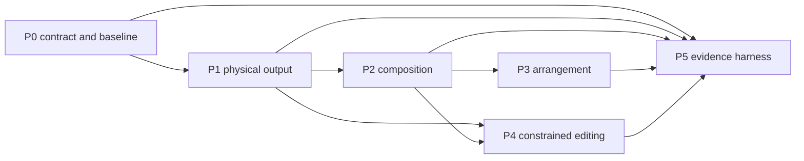

# Moving-head true-up technical plans

Status: **proposed designs; implementation has not begun**. Prepared November 12, 2026
against Twinklr `9c55c2e72c4bfea30a5ab7ae197579e4feb74485`. This continues the
[research report](../report.md) under the owner's instruction to develop technical
design and implementation plans only. All current-session deliverables live here.

## Read order

1. [Shared architecture and contracts](architecture.md): compatibility, data flow,
   units, timing, cache identity, ownership, and newly verified source constraints.
2. [P0 — Behavior contracts and reference cases](phase-0-foundation.md).
3. [P1 — Fixture fidelity and dark movement](phase-1-fixture-fidelity.md).
4. [P2 — Spatial composition and effect families](phase-2-composition.md).
5. [P3 — Musical arrangement](phase-3-arrangement.md).
6. [P4 — Controlled refinement and interoperability](phase-4-refinement.md).
7. [P5 — Evaluation and release decisions](phase-5-evaluation.md).

Each phase contains a technical design and an ordered implementation plan with exact
source/test targets, proposed interfaces, failure behavior, checks, and exit criteria.
Checkboxes describe future work; none implies code was written or tests passed.
New APIs and files are explicitly proposals. Existing workstream phases are unrelated.

## Dependency and delivery map

P5's offline evidence support begins alongside P0/P1; the final release decision waits
for the evaluated features. P4's lock/diff work need not wait for P3. Optional import,
native-effect and visualization experiments are separately gated inside P4 and do not
hold core refinement hostage.

The first useful increment is P0 + P1 + a few P2 families. Keep `legacy_v1` as the
default while `physical_v2` matures. A default change is a separate owner decision
supported by P5 results, not a byproduct of merging the code.

## Prioritized implementation slices

There are **31 planned tasks**, including the optional experiments. The report's
relative phase sizes still apply; these are dependency/priority decisions, not
calendar or staffing estimates.

| Order | Tasks | Reviewable outcome | Main dependency/risk |
|---|---|---|---|
| 1 — preserve the baseline | P0-T1–T4 | Explicit policy, diagnostics, identity, synthetic cases and reference arm | Do not alter old rendering or frozen experiment meanings |
| 2 — establish physical output | P1.1–P1.6; P5-T1–T2 after P1 frame types stabilize | Correct complete fixture bytes, exact interior phase and feasible dark transitions | Profiles, initial state, optical latency and output size |
| 3 — useful composition | P2.1–P2.4 | Named aims, topology and six concrete expressive families | Stable phase/geometry and visibility composition |
| 4A — arrange music | P3-T1–T5 | Categorical motif/variation, restraint and MH/pixel attention | Versioned planner schema and capability admission |
| 4B — preserve good work | P4-T1–T4 | Offline locked refinements and exact differences; guarded application where supported | Boundary dependencies and whole-output isolation |
| 5 — optional pilots | P2.5; P4-T5–T7 | Bounded zoom/import/native/visualization decisions | Concrete fixture evidence and measured workflow value |
| Continuous, then release | P5-T3–T4 | Dated physical/human/authoring evidence and per-feature decisions | Owner observations; no inferred acceptance |

The first useful release candidate excludes the optional pilots and requires P5
transport evidence for its supported subset. Musical and authoring claims wait for
their separate trials. P3 and core P4 can run in separate owned worktrees after
P1/P2 integration, with shared-schema changes merged sequentially.

## Execution conventions

- Read the phase design and [shared contracts](architecture.md) before its tasks.
- One implementing agent owns one isolated branch/worktree; the integrator owns
  sequencing and commits. Task file lists are ownership boundaries. Do not parallelize
  tasks that edit the same model, compiler, exporter, or fixture/test support file.
- The technical test is written first, shown to discriminate, implemented, rerun,
  reviewed, and committed by the authorized integrator. Avoid asserting an implementation
  detail in place of output behavior.
- Exact narrow commands are in each phase. Before completion, commit the intended
  changes, run `make validate` in that owned tree, inspect formatter/lint mutations,
  and resolve failures. No accepted failure is inherited from another workstream.
- No real data, paid provider, hardware or running-show action is authorized by this
  plan. Those experiment steps have explicit evidence/authorization requirements.
- All proposed deletions require a path/rationale/importer/config/doc search record
  before execution. This plan proposes no tracked-code deletions.
- Paths in task file lists are repository-relative. Shorthand `config/`, `sequencer/`,
  `pipeline/` and `formats/` starts at `packages/twinklr/core/`; shorthand
  `moving_heads/` starts at `packages/twinklr/core/sequencer/`. MH agent-local
  `models.py`, `stage.py`, `context.py`, `specs.py`, `orchestrator.py` and prompt packs
  are under `packages/twinklr/core/agents/sequencer/moving_heads/`. Explicit test and
  catalog paths start at the repository root. Each new file is marked Create/new.

## Review and handoff

See [independent design review](review.md) and [planning handoff](handoff.md) for actual
review/check outcomes, limitations, and the next implementable task. Research and
planning completion is distinct from architecture acceptance or implementation approval.
