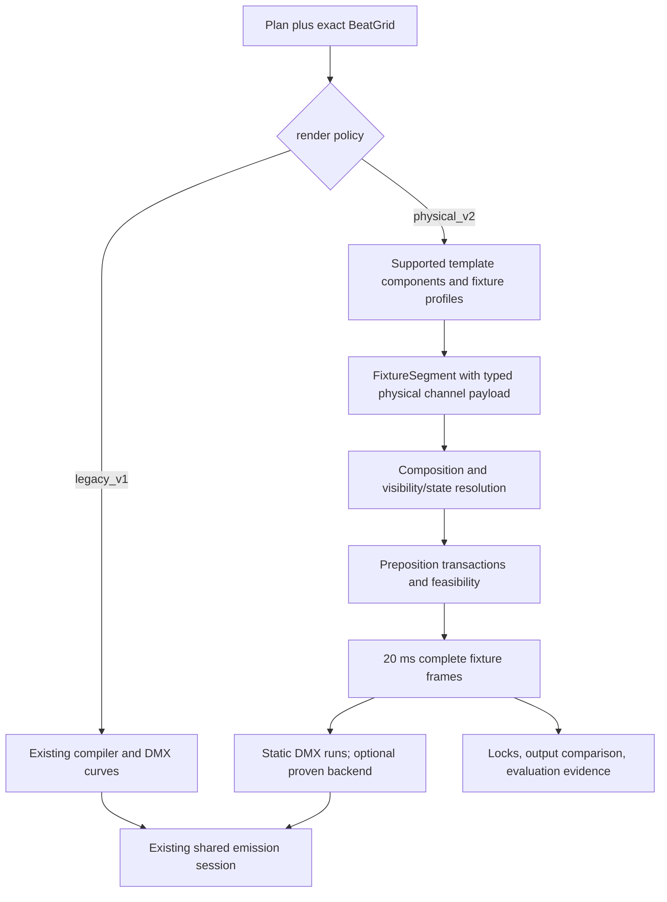

# Shared moving-head design contracts

This is the technical specification shared by the six phase plans. It refines the
[report's architecture and roadmap](../report.md); it does not amend current accepted
behavior. All types and fields marked proposed are future interfaces. Source evidence
was rechecked at `9c55c2e`; upstream xLights is pinned to `fe78fdd` as in the report.

## 1. Goals and boundaries

Build physically interpretable, precisely encoded, musically timed moving-head output;
reusable composition; constrained creative revision; and evidence to judge the result.
Preserve the existing pipeline, templates, emission core, and legacy behavior. Do not
build a live console, generic graph engine, second catalog, full fixture standard,
photorealistic renderer, or autonomous hardware controller.

Global requirements for every task:

- Python 3.13 only; uv workspace; Pydantic V2 for public/LLM-facing data.
- LLMs choose typed categorical intent; deterministic code owns physical values,
  time, curves, channel encoding and file formats.
- `legacy_v1` remains the default; physical behavior changes require explicit opt-in.
- The emitted effect grid remains 20 ms; timing markers remain source-exact.
- Unknown capabilities and unsupported output are explicit; no silent coercion.
- No paid/live provider, owner-local-data, running-show or hardware operation without
  its separately recorded owner authorization. No synthetic human judgments.
- All implementation completion gates include fresh `make validate` in an owned tree.

## 2. Source findings that change the implementation design

| Verified constraint | Consequence |
|---|---|
| `ChannelValue` currently constrains static/clamp values to 0–255 and assumes DMX/normalized curves | Do not put 16-bit words into existing `static_dmx` or reinterpret old curves as degrees. Add a mutually exclusive typed physical payload. |
| `FixtureSegment` already carries identity, section/template provenance and channel values | Retain that top-level IR and extend its payload; do not introduce a parallel renderer graph. |
| `FixtureConfig` drops retired fields called `capabilities` and `movement_speed` | Use proposed `physical_profile: FixtureCapabilities | None`; old ignored fields stay ignored and are not magically trusted. |
| xLights DMX effect renders at most **48 model-relative channels**, and absent settings default to zero | Validate offsets against the backend, compose a full declared fixture state per frame, and reject unsupported profiles. DMX's universe size is not this effect's supported width. |
| Twinklr's emission seam uses 20 ms and stamps 2026.15 | Do not change shared timing/version globally to suit this work. Validate the chosen runtime separately. |
| Current `ChoreographyPlan` lacks a serialized schema-version field | Introduce an explicit new planner envelope while preserving unversioned legacy loading and its omission provenance. |
| Macro models already contain `MotifThread`, `MotifEvolution` and focal roles | P3 binds them to MH components; it does not create another song-level motif owner. |
| Current injection can succeed partially after remote deletion/addition | Prove locks offline and preflight ownership; do not promise atomic live rollback. |
| Existing FSEQ comparison checks whole-file bytes only; preview frames are sampled at 2–4 fps | Neither is a per-channel 20 ms oracle. P5 adds a bounded frame-evidence adapter and retains those existing tools for their original jobs. |

Local sources: [channel state](../../../packages/twinklr/core/sequencer/moving_heads/channels/state.py),
[fixture config](../../../packages/twinklr/core/config/fixtures/instances.py),
[fresh emission](../../../packages/twinklr/core/formats/xlights/sequence/fresh.py),
[emission session](../../../packages/twinklr/core/formats/xlights/sequence/emission.py),
[planner](../../../packages/twinklr/core/agents/sequencer/moving_heads/models.py),
[macro motifs](../../../packages/twinklr/core/sequencer/planning/models.py),
[injection](../../../packages/twinklr/core/api/xlights/injection.py),
[FSEQ comparator](../../../packages/twinklr/core/api/xlights/fseq.py),
[preview sampling](../../../packages/twinklr/core/reporting/evaluation/vision_frames.py).
Upstream: [DMX channel ceiling](https://github.com/xLightsSequencer/xLights/blob/fe78fdddb7524cea71ee4c2ac4c22e20c16d478f/src-core/effects/DMXEffect.h#L20),
[render/default handling](https://github.com/xLightsSequencer/xLights/blob/fe78fdddb7524cea71ee4c2ac4c22e20c16d478f/src-core/effects/DMXEffect.cpp#L81-L99).

## 3. Compatibility and configuration

Proposed `MHRenderPolicy` lives in `config/models.py`, attached as
`JobConfig.moving_heads`. Its initial `mode` is `legacy_v1 | physical_v2`, defaulting
to `legacy_v1`. New nested models forbid extra fields. Job schema accepts `3.0` and
`3.1`, with default `3.0`; selecting `physical_v2` requires explicit `3.1`.
This lets old code reject a new job rather than ignore an unfamiliar option and
silently render legacy behavior. A missing policy in old files retains old behavior.

Keep four independent version concepts: job schema, planner schema, template version,
and renderer policy/implementation revision. A V3 planner response does not automatically
enable physical rendering. A physical render request cannot silently fall back to
legacy because a template has no approved physical implementation. P1 provides an
explicit supported-template list; P2 expands it. Defaults and fallbacks are renderer
configuration, not free-form LLM numbers.

Legacy rendering continues through current handlers and export unchanged. Physical
rendering resolves only supported physical template components into typed trajectories,
then composes, checks and encodes them. Do not reverse-convert current 8-bit values
into apparent high-resolution movement and call that 16-bit support.

## 4. Data flow and ownership

P1 owns `FixtureCapabilities`, physical channel payloads, `InitialFixtureState`,
`RenderLock`, `EncodedFixtureFrame`, and pre-position decisions. P2 owns reusable target,
path, topology and component binding. P3 owns planner projection onto those components.
P4 consumes frames/dependency records to prove edits. P5 consumes the same frames but
compares them to an independently obtained/rendered oracle; comparing a value to
itself is not validation. Exact type definitions/signatures live in their owning phase.

The first physical exporter emits constant per-frame DMX states and merges adjacent
identical states into runs. This is deliberately a correctness-first transport:
coarse/fine byte carries cannot be smoothed independently. It can be larger than current
curves; P1 includes output-size measurement and a declared ceiling, and P4 tests a
native backend only after equivalence can be established. No new output engine is
required: runs become ordinary `EmissionRequest`s on the existing reserved layers.

## 5. Time, units and state

- Physical trajectories use explicitly tagged units (degrees for pan/tilt; normalized
  values for continuous optical/intensity attributes; named values for discrete modes).
  A degree zero and a DMX zero are different things. P1 owns calibrated conversion.
- Absolute integer milliseconds are internal time coordinates. Plan bar indexes retain
  their existing one-based inclusive meaning and are normalized at the adapter seam.
- Exact observed beat knots remain untouched. P1's phase map supplies explicit edge
  provenance because BeatGrid contains beat starts, not guaranteed terminal boundaries;
  limited adjacent-interval inference never becomes an unreported average-BPM fallback.
- Frame samples occupy half-open intervals `[t, t+20)`. Shared emission receives already
  aligned positive-length runs. Do not alter legacy `FixtureSegment` endpoint semantics
  globally; explicitly adapt physical segments and reject accidental zero-duration events.
- Quantize ordinary musical starts to the existing nearest grid, with a 10 ms maximum
  error; allocate dark movement outward (start no later, reveal no earlier than required
  settling) and recheck feasibility after quantization. Musical exactness and optical
  feasibility are separately reported when they conflict.
- Initial pose/darkness is explicit evidence/configuration. Unknown initial state is
  not a zero-angle home. New physical scheduling fails with an actionable diagnostic
  when the first visible cue cannot be justified from known state or a configured dark
  startup interval. It does not invent pre-roll before time zero.
- Compose the complete declared byte state before emission; transitions are multi-channel
  operations, not independently blended DMX indexes. Do not permit foreign high layers
  to invalidate darkness while claiming a physical guarantee.

## 6. Diagnostics, identity and failures

P0 defines `MHDiagnostic` and a render fingerprint. Diagnostic codes distinguish
`legacy_ignored`, `unsupported_attribute`, `unsupported_backend_channel`,
`unknown_initial_state`, `unknown_motion_rate`, `infeasible_transition`,
`lock_conflict`, and `output_budget_exceeded`. Severity is info/warning/error; a
message includes fixture, section, channel when applicable, and the chosen action.
Never report fallback as full realization of the requested effect.

Fingerprint canonical plan + BeatGrid + relevant rig/profile + resolved template/preset
content + renderer policy/revision + backend + frame grid. Record external profile/source
hashes, seed and upstream runtime version with output. Omit wall-clock time and output
paths from functional identity. P3 separately adds capability/target projections to
planner cache identity. Do not invalidate audio analysis for a color-preset-only edit.

New physical behavior defaults to failing on unsupported attributes or infeasible
motion. Optional `preserve_aim`/`drop_accent` policies must be explicitly configured, preserve
locks and visibility constraints, and record the change. Default failure is a design
choice for the opt-in path, not a change to the legacy pipeline's accepted behavior.

## 7. Integration and rollback

P0 config/diagnostic contracts land first. P1 changes channel state, config, compiler and
export together through reviewable tasks; those files are not parallel edit surfaces.
P2 then owns template/path/phase additions. P3 and P4 may proceed on isolated branches
after their P1/P2 interfaces are integrated; the integrator merges shared-schema edits
sequentially. P5 evidence work can run independently once frame contracts are stable.

Rollback selects the earlier renderer policy/config and its matching cached/artifact
identity, or reverts the isolated implementation commit. It does not rewrite accepted
goldens, discard a user's edits, or silently downgrade new physical plans. New profiles
and plans remain versioned artifacts; old binaries are expected to reject new versions.

No design acceptance or execution method is presumed. These documents make the next
implementation scope concrete; the current task ends with reviewable plans.
