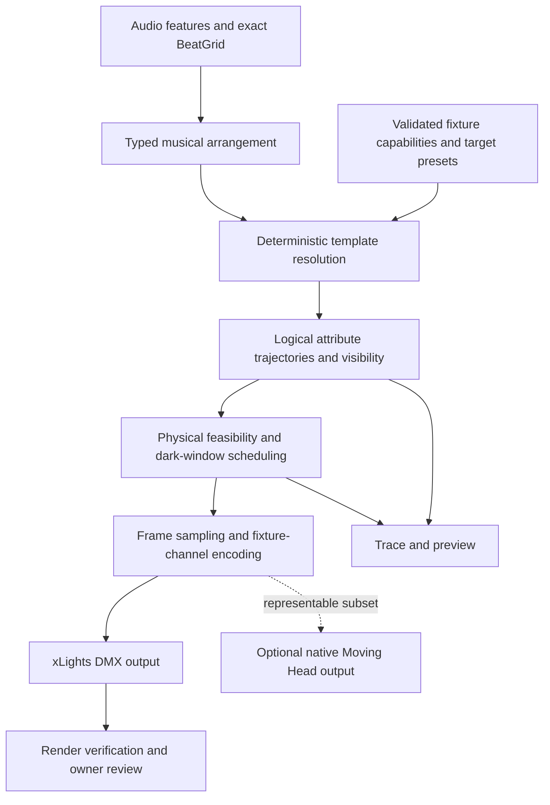

# Moving-head sequencing true-up: xLights, the wider market, and Twinklr

Research date: **November 12, 2026**. Scope: analysis and recommendations only.

## 1. Recommendation

Twinklr should prioritize **fixture-correct output, deliberate movement between cues,
and controllable musical composition**, then expand its effect vocabulary. It already
has 37 composite moving-head templates and a substantial motion library. Adding a
second collection of circles, fans, and sweeps would leave its more consequential
limitations unresolved.

xLights' new generator is valuable because it makes a few choreographic decisions
explicit: when to keep things sparse, when to alternate banks, when to mark a section
change, and when to move a head while dark. Its underlying Moving Head effect also
offers useful parametric motion, fixture conversion, and authoring primitives. These
are two different layers; the song generator does **not** use the whole effect engine.
The generator's own output explicitly disables the Pattern feature. [XG][XH][XE]

The recommended sequence is:

1. Establish a compatibility baseline and make unsupported fixture behavior visible.
2. Complete fixture/channel precision and add a real dark pre-position scheduler.
3. Add reusable positions, relative movement, group topology, and a small set of
   coordinated effects that exploit those foundations.
4. Strengthen phrase-aware composition, restraint, motifs, and whole-show coordination.
5. Make refinement selective, explainable, and measurable; add broader interoperability
   only where a demonstrated authoring need justifies it.

Automatic music analysis alone is not a defensible differentiator: SoundSwitch already
documents phrase-aware Autoscripting. The more promising Twinklr position is an
**editable, reproducible, fixture-aware musical arrangement across moving heads and
pixels**, with typed creative intent, deterministic execution, and evidence explaining
why each cue exists. This is a proposed product direction, not a claim of market
uniqueness or demonstrated quality superiority. See Sections 5–8.

## 2. Evidence, versions, and limits

| Item | Research basis |
|---|---|
| xLights introduction | Official **2026.19** release, published October 23, 2026, explicitly introduces Tools → Generate Moving Head Effects. [XR] |
| xLights source pin | `fe78fdddb7524cea71ee4c2ac4c22e20c16d478f`, master observed November 12, 2026. [XC] |
| Release cross-check | Retrieved `MovingHeadSongGenerator.cpp`, `MovingHeadSongDialog.cpp`, and `MovingHeadEffect.cpp` at both `2026.19` and the pinned master: all three were byte-for-byte identical. Detailed descriptions below therefore apply to those files in the released version too. Panel details are cited to the pinned master unless otherwise stated. |
| Twinklr baseline | Started at `ab1e1457c8b524706f9ebaa55e65af2b743bfb07`; the shared checkout independently advanced to `2d1af61d69a0acc1b5dd877dd64459d9fbfb0f3f` during research. The capability audit accounts for the latter commit. No application code was changed by this research. |
| Other products | Official manuals, first-party help articles, and public source. Source-backed algorithms are distinguished from documented commercial behavior. |
| Experiment performed | Compiled the isolated, wx-free xLights generator in `/tmp` and exercised synthetic timing/head inputs. No xLights application or real fixture was run. Results and reproduction procedure: [research evidence](evidence.md). |
| Not performed | No live providers, owner-local songs/layouts/corpora, real-show mutation, visual calibration, performance benchmarking, or human taste assessment. |

Source citations use named links defined at the end of this report. Local source links
identify implemented behavior, not proof that a real fixture or xLights preview has
accepted it. The priorities here deliberately do not depend on current workstreams.
Existing accepted render semantics remain a compatibility constraint, not a roadmap.

## 3. How xLights Generate Moving Head Effects works

### 3.1 Architecture and entry point

The Tools menu binds `ID_MNU_GENERATEMOVINGHEADSONG` to
`xLightsFrame::OnMenuItem_GenerateMovingHeadSongSelected`. That handler opens
`MovingHeadSongDialog`, extracts timing/model data, calls the pure
`MovingHeadSong::Generate` function, and inserts ordinary `Moving Head` effects into
the sequence. This is a deterministic rule engine, not an LLM or an audio-analysis
model. Its inputs are timing marks, user classifications, fixture order, and parameters.
Audio analysis happens upstream, when timing tracks are created. [XM][XD][XG]

The important separation is the generator's plain-data intermediate representation:
`Section`, `Params`, and `HeadEffect`. A `HeadEffect` contains a head index, start/end
milliseconds, start/end tilt, a dark-link flag, and dimmer control points. The UI owns
sequence mutation; the generator owns composition. Twinklr already follows a similar
planning/rendering separation and should preserve it. [XH][XG]

### 3.2 User workflow and controls

1. Open a sequence and add moving-head models to its sequence elements/Master View.
   Layout models absent from the sequence are listed as unavailable.
2. Create or choose a Bars timing track. The dialog recommends QM Bar and Beat Tracker's
   Bars output. It requires at least two timing marks and assumes four beats per bar.
3. Optionally choose a Sections track, such as QM Segmenter output. Numeric segment
   labels only identify similar-sounding sections; the user supplies their meaning.
4. For each distinct label, mark Chorus and/or Peak. Labels containing `chorus` or
   `hook`, ignoring case, initially select Chorus. Peak is not inferred from audio.
5. Choose heads, flash grouping/rhythm, and dark travel settings, then generate.
   The settings and label classifications are persisted in xLights configuration.
   The result is editable in the normal sequencer. [XD]

| UI control | Default/range | Actual purpose |
|---|---|---|
| Bars timing track | Name-based initial suggestion | Bar start times, not an independently measured beat grid |
| Sections timing track | Optional | Section boundaries and label-derived chorus/peak flags |
| Move-into-position time | 1,000 ms; 0–5,000 | Fallback desired dark travel time |
| Use tilt slew limit | Enabled | Estimate travel from each head's configured tilt speed; zero/unknown falls back to fixed time |
| Chorus flash pattern | Odd/even; alternative left/right halves | Assign heads to alternating banks |
| Chorus flash rhythm | Every two beats; alternatives one beat or one bar | Controls cue density |
| Peak burst spacing | Every four bars; 1–32 | Adds periodic all-head bursts within the implemented chorus branch |
| Chorus/Peak checkboxes | Per distinct section label | Reuses classification for repeated occurrences of that label |
| Head checklist | Initially all eligible models | Selects which heads are replaced/generated while retaining full ordering |

Source: constructor, getters, and configuration methods in [XD][XDH]. The generator
also has fixed/default parameters that the dialog does not expose: pool/sweep/outro
tilt, chorus swing, pool chunk length, burst duration, minimum retained beam length,
and outro thresholds. These should not be described as existing user controls. [XH]

### 3.3 Input normalization and fixture identity

The handler reads **layer zero** of each chosen timing track and sorts its marks by
start time. Bar starts become boundaries; a final endpoint is appended. If the last
mark extends more than 1.5 times the previous bar's length, the endpoint is replaced
with one ordinary final-bar interval. This compensates for Vamp tracks that stretch
the final mark to the end of the song. If mean bar duration is under 1,000 ms, xLights
warns that a beats track may have been selected, but allows the user to continue. [XD]

Eligible types are `DmxMovingHead` and `DmxMovingHeadAdv`. They are ordered by world X
position, with stable sorting for ties. Generation uses **all eligible heads** to
calculate fan placement and banks, then filters output to selected heads. Regenerating
only the outside heads therefore preserves their positions in the original fan.
This is an especially useful design for selective regeneration. [XD][XG]

An individual model must have fixture slot 1–8 and an effect layer to receive output.
That is an eight-slot native-effect addressing scheme, **not a generator-wide limit of
eight models**: effects are placed on each individual model and use its slot. Models
without valid slots/layers are skipped. The full ordering can still include an
unusable model, because eligibility for actual insertion is checked later. [XD][XH]

One UI/source discrepancy matters: the label list scans all timing layers, but actual
section generation uses layer zero. A label displayed only from another layer does
not make that layer participate in generation. [XD]

### 3.4 Bar classification and precedence

The generator sorts sections by start time, initializes every bar as `Pool`, and
checks which section contains each **bar start**. A containing section can classify
it as Chorus and attach a Peak flag. For overlapping sections, the first matching
section in sorted order wins. It does not proportionally split a bar at a section
boundary. [XG]

For every section after the first, the closest bar start is changed to `Sweep`, even
if that bar was Chorus. Finally, for songs of at least six bars, the last two bars
become Outro. Effective priority is **Outro over Sweep over Chorus over Pool**.
With no Sections track, the result is pools plus that automatic outro, rather than
literally only verse bars. There is no automatic opening sweep for the first section.
[XG][XH]

This is an economical arrangement policy: low activity between meaningful changes,
special treatment of section entries, denser choruses, and an explicit ending.
It is also intentionally limited: there is no lyric, instrumental role, downbeat
confidence, time-signature, or subjective energy analysis inside this function.

### 3.5 Exact generated vocabulary

For head index `h` among `H` heads, define normalized fan position
`f = (h - (H-1)/2) / ((H-1)/2)`, or zero for one head. All generated effects use
**pan = 90 degrees**. The fan and movement below are expressed through signed tilt;
the section sweep is not a changing-pan sweep. Dimmer values are normalized 0–1.
These numbers describe xLights defaults, not recommended universal fixture settings.
[XG][XH]

| Cue | Placement | Motion | Dimmer envelope |
|---|---|---|---|
| Pool | Consecutive pool bars, grouped into two-bar chunks | Static tilt `12f` degrees | Start 0, midpoint 0.6, end 0 |
| Section sweep | One bar nearest each later section start | Tilt from `55f` to `10f` | 0 at start, 1 at 15%, held to 70%, 0 at end |
| Chorus ping-pong | One-, two-, or four-beat windows | Base tilt `20f`, traversing base ±18 degrees, direction alternating with bar/window parity | 1 at start, linearly down to 0 |
| Peak burst | Eligible chorus bars at the selected spacing | All heads at tilt 0 | Several short peaks within at most 500 ms or one quarter-bar, whichever is shorter |
| Outro | One effect spanning final two bars, when at least six bars exist | Tilt from `40f` to 0 | 0 at start, 0.8 at 40%, 0 at end |
| Dark pre-position | Gaps before visible cues, including any initial gap | Static target equal to next cue's starting tilt | Flat zero throughout |

The chorus divides each bar into four equal time intervals; it does not use measured
within-bar beat timestamps. Bank alternation uses a global window count, so whole-bar
flashes alternate across bars. Odd/even means index parity; left/right puts
`ceil(H/2)` heads in the first bank. A single head therefore participates only in the
windows belonging to its bank. [XG]

Peak scheduling is relative to the containing section: with default spacing four,
the condition targets section-relative bar indexes 1, 5, 9, and so on. Index zero
commonly contains the section sweep. A burst occupies the start of the first chorus
window; that window's bank uses the remainder unless less than 150 ms remains. **Peak
alone is insufficient**: the burst code is inside `BarKind::Chorus`. Ticking Peak on
a non-Chorus section produces no burst in the examined version. This is confirmed by
the isolated synthetic probe, not merely inferred from the label wording. [XG]

The burst control-point list begins with `(1,0)` before points at smaller x values and
ends with `(1,0)` again. The renderer inserts points through `ValueCurve::SetValueAt`;
do not copy this list into a library that assumes monotonic input. This report has not
rendered the burst to establish its exact visible envelope. A port should define
sorted, validated attack/hold/release points and test the resulting signal. [XG][XE]

### 3.6 Dark movement and physical feasibility

After generating visible cues, xLights processes each head independently in time order.
For consecutive cues, it measures `abs(next.tilt0 - previous.tilt1)`. When a positive
tilt slew limit is available, desired travel time is approximately:

`travel_ms = floor(delta_degrees / slew_degrees_per_second × 1000 × 1.15) + 50`.

Otherwise it uses the configured fixed lead-in. If the pose changes by at least one
degree and the gap is too short, it trims the previous cue's end, retaining at least
40% of its original duration and at least 100 ms. Every gap of at least 25 ms receives
a flat-dark link effect covering the **whole gap**, not merely the estimated travel
duration. Touching equal-pose cues need no borrowed time. The first cue has no known
previous pose and cannot receive time before zero. [XG][XH]

This is a useful heuristic, **not a proof of physically feasible motion**. The previous
cue can be shortened only so far; no failure is reported if the remaining travel time
is inadequate. Acceleration, pan movement, wheel settling, initial pose uncertainty,
and fixture-specific latency are not part of this calculation. Shortening the effect
also compresses its tilt/dimmer progression into less time. Our synthetic 1-degree/sec
case confirms that an insufficient dark interval can remain. [XG]

The generated dark effect commands the next pose immediately at zero dimmer; it is
not a sampled interpolated transit curve. The physical head travels toward that
target. Its serialized `MHLinkToNext` flag supports the panel's linking workflow,
but the renderer reads the stored head settings. Twinklr should resolve links into
explicit renderable data at compile time rather than depend on later panel selection
or editing to compute them. [XG][XE][XP]

Optical darkness also depends on the fixture mapping: the renderer writes dimmer only
when a dimmer channel is configured, and the generated link does not explicitly issue
a fixture-specific shutter-close command. A dimmerless or unusually mapped fixture
therefore needs separate validation; a record labeled dark is not itself proof that
the beam is extinguished. [XG][XE]

The separate panel linking facility calculates the next effect's starting pan/tilt,
including its paths/patterns; substitutes static position and all-zero dimmer into
the linked effect; and copies the next effect's color/wheel setting. It does not copy
the next effect's shutter-open commands. The controls for path/pattern/dimmer are
disabled while linked. This is an authoring convenience beyond the song generator's
fixed-white implementation. [XP]

### 3.7 Sequence mutation and output format

The handler creates one Undo step, removes **unlocked effects across all effect layers**
of usable selected heads, and adds generated effects on layer zero. It preserves
locked effects, which may cause insertion overlaps/failures. It snaps start/end times
to the sequence's frame interval, drops zero-length results, marks the sequence dirty,
renders affected models, refreshes the grid, and reports added/skipped/failed counts.
It is not an atomic all-or-nothing replacement transaction: failed insertions are
counted after deletion. [XD]

`BuildSettings` produces native Moving Head settings, with one populated
`E_TEXTCTRL_MH{fixture}_Settings` slot among eight. It uses a static tilt for small
changes or a Ramp value curve when the tilt difference is at least one degree.
Angles in the curve's serialized parameters use tenths of degrees. Commas inside
per-head data are escaped as `&comma;`. Lit cues have white color, dimmer points,
shutter-open intent, one cycle, and no Pattern. Dark cues have zero dimmer and static
pose. The palette is white. [XG]

Twinklr currently exports DMX effects rather than this native Moving Head format.
Both can ultimately control the same fixture, but copying these strings is not a
drop-in change to Twinklr's renderer. Native-effect emission would be a separate,
versioned interoperability feature with its own round-trip and xLights acceptance
tests. Section 4 discusses the current exporter.

### 3.8 The broader Moving Head effect engine

The native effect can do substantially more than the generator selects:

| Capability | Source-backed mechanism | Transfer value |
|---|---|---|
| Parametric patterns | Circle, Eight, Line, Line2, Diamond, Square, SquareChoppy, SquareTrue, Leaf, Lissajous | A compact normalized path library with explicit semantics |
| Pattern transforms | Width/height, X/Y center, rotation, initial phase, per-head phase offset; independent X/Y frequency/phase for Lissajous | Recombine a few kernels instead of multiplying templates |
| Animated rotation | Rotation value curve evaluated over the effect | Rotating elliptical or polygonal arrangements |
| Group placement | Head ordering, group size, per-slot pan/tilt offsets and time offsets | Reusable topology and phase distribution |
| Drawn paths | Sketch path sampled over progress, scaled and transformed into angular positions | Authored signatures and non-periodic paths |
| Position curves | Static values or value curves for pan/tilt and offsets; cycles control progress | Editable motion independent of musical cue selection |
| Color/dimmer | RGB color interpolation, stepped wheel colors, custom dimmer points | Attribute composition rather than motion-only effects |
| Wheel masking | Auto Shutter uses wheel delay and wheel-index distance to darken transitions | Hide unwanted intermediate colors |
| Fixture conversion | Motor angle limits, orientation/home, inversion, coarse/fine output bytes | Fixture-correct motion output |
| Reusable presets | Separate XML preset kinds for complete head settings, paths, dimmers, and patterns | Independent authoring assets and controlled reuse |

Sources: [XE][XP][XMotor]. These capabilities must not be credited to the song generator
itself. Nor does the examined native effect parser establish generalized gobo, prism,
focus, or zoom sequencing; the parsed commands center on motion, color, dimmer, and
shutter. Model support elsewhere is not the same as this effect authoring an attribute.

The pattern math is simple enough to understand and independently implement. It
evaluates a normalized 2D point, applies scale/rotation/center, and replaces enabled
pan/tilt axes. For example, Circle uses `x=cos(t+π/2), y=cos(t)`; Eight doubles the X
frequency; Lissajous uses independent axis frequencies/phases. Square is piecewise
linear around its perimeter; SquareTrue jumps between corners; SquareChoppy rounds
sinusoids. These last two are visibly and mechanically different from smooth motion.
Pattern width/height multiply normalized coordinates, so they act as amplitudes in
the source math, not necessarily full peak-to-peak spans. Phase is wrapped to `[0,1)`.
The existing position is overwritten by Pattern output, rather than automatically
serving as the relative center. [XE]

The custom drawn-path engine is different: it maps a sketch into a plane, rotates
that plane using the current pan/tilt, and derives output angles using trigonometry,
with a correction for backwards pointing. This is a beam-direction construction,
not a calibrated world-coordinate target solver. [XE]

### 3.9 What to harvest, and what to leave behind

| xLights idea | Twinklr disposition | Priority | Reason |
|---|---|---|---|
| Plain cue records before serialization | Extend existing compilation records | P0 | Makes scheduling independently testable |
| Dark pre-position links | Implement semantic look-ahead transitions | P1 | Strong visual/physical benefit; incomplete today |
| Slew-derived lead time | Generalize to pan, tilt, and relevant attribute settling | P1 | Move feasibility should govern cue scheduling |
| Stable full-head ordering for subset output | Apply to partial regeneration and rig groups | P1 | Prevents a retained fixture from changing role unexpectedly |
| Sparse pools, alternating chorus banks, section sweeps | Add as deterministic reference arrangement/policies using existing templates | P2 | Good baseline and restraint; no need to duplicate motion kernels |
| Fixture-angle conversion and 16-bit byte split | Complete current exporter semantics | P1 | More important than adding new shapes |
| Wheel transition masking | Add capability-aware dark attribute changes | P1/P2 | Prevents visible wheel travel artifacts |
| Separate position/path/dimmer/pattern presets | Add reusable references within existing template system | P2 | Encourages recombination and rig adaptation |
| Transformable pattern kernels | Extend existing movement library selectively | P2 | Especially rotation, relative centers, Lissajous and path controls |
| Native Moving Head serialization | Optional backend experiment | P4 | Better manual editability may justify it; not needed for core motion correctness |
| Four-beats-per-bar assumption | Do not adopt | — | Twinklr already has an exact BeatGrid abstraction |
| Hard-coded angles, white palette, fixed outro | Use only as a baseline/preset | — | A musical planner should choose these deliberately |
| Delete all unlocked layers | Do not adopt | — | Preserve Twinklr's reserved-layer ownership model |
| Shorten cues without proving feasible travel | Do not adopt as final policy | — | Report infeasibility or use a deterministic fallback |
| GUI-dependent link refresh / eight-slot addressing | Do not import into core domain | — | These are xLights representation constraints |

The transfer matrix is an engineering recommendation derived from [XG][XD][XE][XP],
not a proposal to copy the C++ wholesale.

### 3.10 Synthetic source experiment

With twelve 2-second bars and four heads, the isolated generator produced:

| Input | Lit records | Dark records | Burst records |
|---|---:|---:|---:|
| No sections | 24 | 4 | 0 |
| One Peak-only section | 24 | 4 | 0 |
| Four verse bars followed by Chorus + Peak | 44 | 36 | 8 |

Burst records are included in the lit count. Selecting heads 0 and 3 generated exactly
the filtered full-head result, including timing and tilt. A deliberately slow fixture
retained an insufficient travel gap, confirming the heuristic's limitation. These
are source-function results only; they say nothing about subjective quality, UI
mutation success, rendered frame output, or physical movement. [Evidence](evidence.md)

## 4. Twinklr's actual baseline and gaps

### 4.1 Capabilities already implemented

The baseline is materially richer than the xLights generator. It has **37 composite
builtins**, **30 movement enum entries including NONE**, **18 geometry entries including
NONE**, and **six dimmer entries including NONE**. These counts are different kinds of
objects, not comparable effect-quality scores. Existing looks include sweeps/fans,
circles, figure-eights, infinity, spirals, waves, pendulums, random/ballyhoo motion,
stomps, snap/pop-lock accents, build/drop/recover, and multi-step intro/main/outro
phrases. Sources: [builtin registry][TBuiltins], [movement][TMovement],
[geometry][TGeometry], [dimmer][TDimmer].

| Area | Implemented foundation | True-up opportunity |
|---|---|---|
| Templates | Complete geometry/movement/dimmer units, optional color/shutter/gobo, semantic targets, repeats, presets and patches; JSON `TemplateDoc` and Python factories share a validating registry | Reuse this system for new families and references; avoid another catalog/schema |
| Curves | Sine/cosine, Lissajous-based figure-eight, noise, holds, triangles and other primitives | Reusable path transforms and explicit relative centers; math names alone are not gaps |
| Timing | Exact beat/bar boundaries; fractional bar lookup; template/section endpoints use actual boundaries; timed intent events can slice existing curves | Internal phase still needs exact beat-time evaluation for tempo changes |
| Scheduling | PING_PONG/JOINER, hold/fade/truncate remainder policies, multi-step offsets/overlap, partial-cycle clipping | Explicit finite-event/loop/end-state contracts and physical transition windows |
| Group phase | Ordered fixture lists and linear phase spread | Blocks, wings, grids, independent attribute-domain phase and stable subset semantics |
| Planning | Typed section/template/preset choices, categorical intensity/color, timed shutter/gobo, MomentCues, transition hints; one-to-three subsegments; deterministic selector already exists | Motif relationships, visibility budget and richer categorical composition |
| Delivery | DMX effects, custom channel curves, higher-layer transitions, grouping of identical compatible segments | True high-resolution emission and optional native Moving Head authoring backend |
| Iteration | Guarded injection, per-section regeneration, ownership/collision checks, preview/contact-sheet and sync-metric tooling | Attribute locks, dependency-aware regeneration, understandable review differences |
| Whole show | Shared macro/timing, focal-role/brightness coordination, palette binding and call/response | Persistent cross-media motifs and measured attention/contrast quality |

Sources by row: [template models][TTemplate], [template loader][TLoader];
[movement handler][TMH], [parametric curves][TParametric]; [BeatGrid][TBeat],
[template compiler][TCompiler], [intent resolution][TIntent]; [scheduler][TScheduler];
[phase offset][TPhase], [step compiler][TStep]; [planner models][TPlanner],
[selector][TSelector]; [XSQ adapter][TXSQ]; [injection][TInjection],
[vision frames][TFrames], [sync metrics][TSync]; [show coordination][TShow].

### 4.2 Output and physical correctness gaps

**16-bit fields do not establish 16-bit output.** `DmxMapping` declares fine channels
and `use_16bit_pan_tilt`, but `DmxSettingsBuilder` maps six coarse logical channels
(pan, tilt, dimmer, shutter, color, gobo). It does not split a resolved high-resolution
axis into paired coarse/fine samples. The flag adds fine-channel inversion settings;
the corresponding test checks those flags, not reconstructed motion resolution.
This is a high-priority implementation gap. Independent interpolation of coarse/fine
curves is also insufficient without testing byte carries at rendered frames.
[Fixture mapping][TDMX], [builder][TBuilder], [builder tests][TBuilderTests]

**Move-in-dark is not the current transition model.** Twinklr has transition detection,
planning, and higher-layer blending, including `FADE_VIA_BLACK` and `SEQUENCE`.
However, those strategies interpolate individual numeric channel values. Sending a
color wheel toward DMX zero does not guarantee optical darkness, and closing a shutter
is not universally equivalent to sending zero. A synchronized transaction must reserve
time, extinguish the fixture, move/settle attributes, and reveal on the intended cue.
No such look-ahead physical scheduler was found in the current path.
[Transition planner][TTransition], [channel blender][TBlend]

**Movement intensity and calibrated limits need an explicit migration.** The movement
handler replaces its received intensity with `params.get("intensity", SMOOTH)`.
Shipped templates do not supply that override, so plan/preset movement intensity is
ineffective even though dimmer intent can change. Dynamic excursion is bounded to the
normalized 0–1 range, not guaranteed to the configured pan/tilt window. Calibration
data exists and static conversion can use it; that is not an end-to-end emitted-motion
guarantee. Template dimmer defaults likewise survive as metadata without controlling
the final dimmer floor. [Movement handler][TMH], [intent][TIntent],
[fixture instances][TInstances], [dimmer handler][TDimmerHandler]

These behaviors are tied to an owner-directed restoration of the previously accepted
look. They should not be silently reversed while importing a better formula. Propose
new template versions or an explicit opt-in motion policy, compare both outputs, and
obtain visual acceptance before migration. The later `2d1af61` correction already
changed non-closing dimmers in multi-step templates to shift without wrap; pan/tilt
still wrap. Consequently, the older decision's specific warning about a wrapped
`build_drop_recover` dimmer is not a description of the final audited implementation.
No new visual acceptance is inferred from that correction.
[Accepted behavior decision][TDecision], [step compiler][TStep]

**Attribute coverage is narrow and has a concrete channel limit.** Current MH mapping
and handlers cover wheel-based color/gobo plus shutter, pan/tilt and dimmer. They do
not provide full RGB/RGBW/CMY mixing, zoom, focus, iris, frost, prism, gobo rotation,
CTO, or multi-cell head realization. A missing named wheel entry can fall back to
open. Shutter intent on a mapped channel above 16 is explicitly dropped with a trace,
even though defaults may address a higher channel. Capability filtering must happen
before selecting a look, and requested but unsupported attributes must be visible.
[Fixture mapping][TDMX], [wheel handlers][TWheels]

**Musical timing has exact boundaries but incomplete internal phase semantics.** The
dimmer handler computes cycle count using `period_bars × beat_grid.ms_per_bar`, where
`ms_per_bar` is an average. A uniform curve spanning variable-tempo bars can therefore
miss internal beats despite exact endpoints. Shutter PULSE alternates by sample index,
without BeatGrid or a period input. These are specific gaps to test; they do not mean
the entire renderer lacks musical timing. [Dimmer handler][TDimmerHandler],
[BeatGrid][TBeat], [wheel handlers][TWheels]

### 4.3 Spatial and authoring limitations

Current geometry largely operates in normalized/DMX or angular space. Fixture
position indexes and mounting offsets exist, but the audited MH domain does not
provide a full fixture XYZ pose and calibrated world-target solver. Semantic roles
also do not uniformly generalize to arbitrary head counts: role inference can produce
MID_LEFT/MID_RIGHT while the fan handler's role list falls back to center for unknown
roles. Address topology separately from named small-rig roles before claiming
portable choreography. [Fixture instances][TInstances], [fixture builder][TFixtureBuilder],
[fan geometry][TFan]

Phase offsets currently shift pan, tilt and dimmer together, with the one-shot dimmer
exception above. That supports ordinary chases, but cannot directly express a motion
wave with a separately timed dimmer/color chase or mirror-wing phase distribution.
The opportunity is to add selective phase domains and group transforms, not replace
the existing scheduler. [Phase calculation][TPhase], [step compiler][TStep]

The current exporter explicitly creates `DMX` effects. A native Moving Head backend
could improve editability, but would need to declare which intent is representable,
preserve frame/channel behavior, and retain DMX fallback. Preview, regeneration, and
evaluation utilities already exist; a usable review loop and constrained edits are
more valuable than rebuilding those utilities. [XSQ adapter][TXSQ], [injection][TInjection]

## 5. Other projects and products

This survey samples an open-source controller, major professional-console effect
models, automated DJ lighting, a desktop lighting product, fixture standards, and a
visualizer. It is broad enough to identify repeated design patterns, but not an
exhaustive market or patent search. Commercial internals are unavailable: the report
describes their documented semantics and proposes a Twinklr implementation, rather
than claiming to have recovered their algorithms.

### 5.1 QLC+: EFX and the v5 Show Wizard

QLC+ source was inspected at
`167da48141c60d820cd715f52bb535ad1cc0ecc1` (November 10, 2026). The v5 manual exposes
normalized patterns, width/height/center/rotation, axis frequencies/phases, per-fixture
phase, relative movement, direction, repetition modes, and fixture distribution.
Its Show Wizard builds fixture-role/function/Virtual Console configurations, with
capability-gated looks and generated position scenes. It is not documented as a
song-audio or phrase-analysis engine. The v5 manual describes development functionality;
do not assume an installed older stable release has it.
[EFX editor](https://docs.qlcplus.org/v5/function-manager/efx-editor),
[Show Wizard](https://docs.qlcplus.org/v5/fixtures-and-functions/show-wizard)

The source's `calculatePoint` produces normalized shapes, and `rotateAndScale` applies
transforms and fade-in amplitude. Its dimmer function shares motion phase: the first
half-cycle follows `(cos(angle)+1)/2`, and the return half is dark. That provides the
key mechanical idea for a flyout: visibility must be coupled to travel direction.
[Pinned EFX source](https://github.com/mcallegari/qlcplus/blob/167da48141c60d820cd715f52bb535ad1cc0ecc1/engine/src/efx.cpp#L304-L503)

The wizard combines a base Position scene and relative EFX for circle/eight/audience
movement, deriving range from fixture physical values. Its group resolver uses the
first fixture as representative, so this is not complete heterogeneous-rig adaptation.
Fly generation is an exception: absolute tilt EFX, fixed reference offsets, coupled
dimmer, and no base-position Collection. Both Fly In and Fly Out call the same function;
that function ignores the passed algorithm, chooses `Line`, and uses the label for
naming. At this source pin they **appear to produce identical motion settings**. This
is a source inference, not a runtime defect demonstration.
[Relative movement builder](https://github.com/mcallegari/qlcplus/blob/167da48141c60d820cd715f52bb535ad1cc0ecc1/qmlui/stagewizard/stagewizard_functions.cpp#L773-L909),
[fly call sites](https://github.com/mcallegari/qlcplus/blob/167da48141c60d820cd715f52bb535ad1cc0ecc1/qmlui/stagewizard/stagewizard.cpp#L1321-L1339),
[fly builder](https://github.com/mcallegari/qlcplus/blob/167da48141c60d820cd715f52bb535ad1cc0ecc1/qmlui/stagewizard/stagewizard_functions.cpp#L912-L993)

**Twinklr implementation:** extend existing curve/handler interfaces with normalized
path transforms; share phase between movement and visibility; create truly distinct
fly-in/out envelopes; resolve base targets per fixture. Test direction while lit,
not just the oscillating curve. Borrow capability gating and reviewable generation,
without importing the wizard's console UI, fixed offsets, or representative-fixture
assumption. The inspected EFX file carries Apache-2.0 licensing.

### 5.2 grandMA3: phasers, recipes, and MAtricks

Phasers animate attributes through steps, with absolute/relative values, width,
transition, acceleration/deceleration, and global speed/phase/measure controls.
Recipes reference selections and presets; phaser recipes add preset-based steps.
The recipe editor separates shape defaults from explicit overrides and includes
curves such as easing, snap and swing. MAtricks distributes/mirrors values through
Blocks, Groups and Wings, including odd-count symmetry. These are documented
authoring/playback semantics; proprietary implementation was not inspected. Some
`/2.5/` URLs display v2.4 content, so version labels should be read on the page.
[Phasers](https://help.malighting.com/grandMA3/2.5/HTML/phaser.html),
[Recipe editing](https://help2.malighting.com/grandMA3/2.5/HTML/edit-recipe-mode.html),
[Recipe sheet](https://help2.malighting.com/grandMA3/2.5/HTML/recipe-sheet.html),
[MAtricks Transform](https://help2.malighting.com/grandMA3/2.5/HTML/matricks_transform.html)

**Twinklr implementation:** separate fixture selection/order/distribution from path
evaluation. Add deterministic blocks, groups, mirrored wings, grids, and seeded
shuffle policies, with explicit handling of odd counts and missing heads. Allow
tested templates to reference named target/attribute states and retain source-of-value
metadata for defaults and overrides. A motif can then recur with a wider spread or
different phase without becoming an unrelated template. Do not recreate the entire
console programmer or expose arbitrary numeric phaser programs to the LLM.

### 5.3 ChamSys MagicQ: base values, group FX, and palette FX

MagicQ separates base values from effects. Normal FX offset the base, while Plus,
Minus and Abs select other combination semantics. Spread distributes phase, Parts
repeats a phase cycle across subsets, and Segments groups adjacent heads. Group FX
follow group membership changes; Palette FX reference reusable color, position or
beam states. Its multi-attribute examples include TiltDim. Color flicks can have
transparent intervals that reveal the underlying base. These are manual-level
semantics, not an inspection of proprietary playback code.
[MagicQ 1.9.9.x FX engine](https://secure.chamsys.co.uk/docs/magicq/1.9.9.x/manual/FX_engine.html)

**Twinklr implementation:** define attribute composition before introducing overlays:
relative addition for bounded motion, multiplication for intensity, replacement for
discrete wheel states, and release-to-base for temporary accents. Add dependency-aware
position/color/beam references. A circle should keep running when its base aim moves;
a brief color flick should return to the prior palette; changing group membership
should preserve a deterministic phase policy. Wheel indexes must never be treated as
ordinary additive color values.

### 5.4 Avolites Titan: key frames and move in dark

Titan 19 key-frame shapes interpolate captured states or referenced palettes/cues.
They expose phase, beats per cycle, finite cycles, and per-frame timing/curve controls;
palette edits propagate to their references. Cue-list Move In Dark offers Off,
Disabled, Early and Late modes. Early moves when intensity reaches zero; Late uses
the last suitable cue before the fixture is needed. The older Titan 15.1 manual adds
delay/fade/inhibit details, which are historical evidence rather than a fresh v19
implementation verification.
[Key Frame Shapes](https://manual.avolites.com/docs/effects/key-frame-shapes/),
[Cue List Options](https://manual.avolites.com/docs/cue-lists/cue-list-options/),
[Titan 15.1 manual](https://web3.avolites.com/Portals/0/downloads/manuals/titansuite/TitanManualV15.1.pdf?ver=2022-04-04-153249-000)

**Twinklr implementation:** distinguish cyclic dark return strokes from cue-to-cue
pre-positioning. The latter needs future visibility, arrival pose, available dark
windows, and settling estimates. Support early/late policies where useful, plus a
declared infeasibility fallback. Add explicit finite-shot/hold/continue end states;
do not force every path to close. References and key frames can live in validated
data templates before a visual editor is justified.

### 5.5 SoundSwitch: the closest automated-authoring comparison

SoundSwitch documents automatic music analysis and generation using saved presets
and styles. Detected phrase types include Intro, Outro, Main 1, Main 2, Middle and
Bridge. This establishes functional competition, not comparable quality or knowledge
of its detection/generation algorithms.
[Product overview](https://www.soundswitch.com/software.html)

Phrase Editing supports changing/splitting/deleting phrase regions, beat/bar snapping,
and disabling phrases so existing scripted material survives re-autoscripting. Fixture
categories influence generation, and phrases can use different presets. These are
important authoring controls to benchmark.
[Phrase Editing](https://support.soundswitch.com/en/support/solutions/articles/69000844233-soundswitch-phrase-editing)

Autoscript Autoloops, documented for 2.7+, accepts 16/32/64/128-bar lengths and ordered
Position/Attribute Cues; movement effects include circles and figure-eights around
position cues. Attribute Cues provide reusable gobo/prism/focus/zoom and other special
functions, distinct from the basic intensity/color/pan/tilt/strobe tracks.
[Autoloop autoscripting](https://support.soundswitch.com/en/support/solutions/articles/69000844240-soundswitch-how-to-autoscript-autoloops),
[Attribute Cues](https://support.soundswitch.com/en/support/solutions/articles/69000828942-soundswitch-controlling-gobo-prism-more-with-attribute-cues)

**Twinklr implementation:** build on existing section regeneration with separate locks
for timing, target/motion, color, intensity, and fixture group. Prove locked output
unchanged, including transitions at edited boundaries. Make lead/support/texture roles
editable and capability-aware. Benchmark edit burden, phrase contrast, motif retention,
and timing rather than the number of emitted effects. SoundSwitch's existence means
“AI makes a show from a song” is insufficient positioning on its own.

### 5.6 Lightkey: logical attributes and relative paths

Lightkey documents a logical fixture-control layer that defers DMX generation,
8/16-bit properties, relative position effects, effect overlays, spatial/custom order,
mirroring, reusable paths with smooth/linear/point interpolation, and fixture limits
and offsets. Its listed optical attributes include focus, zoom, iris, frost, prism,
and gobo controls; timing can follow MIDI Beat Clock, Ableton Link or OS2L. These are
documented capabilities, not measured performance or recovered internals.
[Technical specifications](https://lightkeyapp.com/en/specs)

**Twinklr implementation:** separate aim, reach, rate, visibility and optical intent.
Resolve them to physical properties, then encode DMX. Add optical families only when
validated profiles support them. A narrow-beam cue can use zoom where available and
an explicit fallback otherwise. Live clock integration is not a prerequisite for
Twinklr's offline song-to-sequence workflow.

### 5.7 GDTF and Open Fixture Library: useful fixture data

GDTF describes significant-byte ordering, logical-channel snap behavior, physical
endpoints, move-in-black/channel-change timing, real fade/acceleration, wheels, and
mode dependencies. Such fields can support conversion and feasibility estimates, but
defaults or omissions are not measured fixture performance.
[GDTF DMX Mode specification](https://www.gdtf.eu/gdtf/file-spec/dmx-mode-collect/)

OFL provides fixture personalities with modes, channels, capabilities, fine/switching
channels, matrices and wheels. Its internal JSON format can change incompatibly;
its documentation recommends export plugins for stable application integration.
The repository identifies an MIT license.
[Fixture format](https://github.com/OpenLightingProject/open-fixture-library/blob/master/docs/fixture-format.md),
[License](https://github.com/OpenLightingProject/open-fixture-library/blob/master/LICENSE)

**Twinklr implementation:** normalize a bounded supported subset into Pydantic fixture
models, with source/version/confidence and warnings. Initially prioritize the axes
Twinklr actually emits. Reject or expose unsupported dependencies instead of guessing.
Filter incompatible looks before planning. Full GDTF support is not required to
correct today's mapping or add a reliable move-in-dark feature.

### 5.8 BlenderDMX: optional independent visualization

BlenderDMX imports GDTF fixtures and MVR scenes, receives Art-Net/sACN, records DMX into
keyframes, and uses Blender visualization. Its project describes real-time performance
limits, particularly with dynamic scenes/network input, and unsupported framing
shutters. It is an adjacent visualizer, not an automatic choreographer, and identifies
GPLv3 licensing.
[Project capabilities and status](https://blenderdmx.eu/)

**Twinklr implementation:** consider a synthetic offline replay scene after xLights
compatibility is established. It may reveal coordinate or fixture-definition errors;
it cannot replace physical validation or taste review. A new photorealistic renderer
or real-time output stack is a poor first investment for this true-up.

### 5.9 Cross-product synthesis

| Repeated capability | Strong references | Twinklr stance |
|---|---|---|
| Position + relative motion | QLC+, MagicQ, Lightkey, SoundSwitch | High-value extension of existing movement handlers |
| Fixture topology independent of shape | grandMA3, MagicQ, QLC+ | High-value portability and phase improvement |
| Coupled movement/visibility | QLC+ flyouts, MagicQ TiltDim | Add tested effect families with shared phase |
| Dark pre-positioning | xLights, Titan | Highest-priority transition capability |
| Reusable attribute states | grandMA3, MagicQ, Titan, SoundSwitch | Add references within existing templates |
| Selective regeneration/phrase preservation | SoundSwitch | Extend existing guarded regeneration |
| Logical physical attributes before DMX | Lightkey, GDTF/OFL | Close precision and capability gaps |
| Live busking, MIDI controllers, console layouts | Several products | Outside this research's recommended core scope |

These are established design patterns to adapt. Their value comes from integration
and reliability, not claiming each primitive as a Twinklr invention.

## 6. Target capability design and effect backlog

### 6.1 Preserve the existing architecture

The following is a proposed extension, not an accepted schema change. Keep Pydantic as
the single source for planner-facing contracts. Let the LLM choose roles, motifs,
qualitative reach/rate/energy, palette families, target names, and section relationships.
Deterministic code chooses coordinates, curves, exact phase, travel windows, fixture
values, frame boundaries and file settings. Existing tested templates remain the
unit of choreography; reusable components make them easier to vary and adapt.

### 6.2 Minimum useful contracts

| Proposed concept | Minimum responsibility | Existing integration point |
|---|---|---|
| Fixture capability record | Attribute type, physical/DMX mapping, resolution, valid modes, open/closed states, known travel/settle data, provenance | `config/fixtures/`, rig/calibration adapters |
| Named target/attribute preset | Per-fixture aim or optical state; optional later world-target definition; explicit missing-fixture fallback | Template/rig models and existing preset resolution |
| Motion component | Path + reference target + transform + musical phase; distinguish periodic paths from finite events | Existing movement handler, curve registry and `TemplateDoc` |
| Selection/distribution policy | Stable identity/order, blocks/groups/wings/grid and attribute-specific phase | Fixture builder and `compile/phase_offset.py` |
| Visibility envelope | Attack/hold/release or dark-return mask tied to musical/motion phase | Dimmer/shutter handlers and template steps |
| Transition transaction | Multi-channel extinguish/move/settle/reveal with explicit feasibility result | Transition planner/compiler and `FixtureSegment` |
| Arrangement relationship | Motif identity, reprise/variation, lead/support role and restrained/peak density | Existing MH planner, macro plan, deterministic selector |
| Edit constraint | Locked interval/fixture/attribute and dependencies allowed to change | Guarded regeneration/injection and ownership metadata |

Do not add these as a separate framework all at once. Introduce the smallest fields
needed by the first accepted fixture/transition/effect cases, with explicit versions
where output changes. Keep numeric physical parameters in fixture/template/render
configuration, outside the LLM's free-form control surface.

### 6.3 A concrete dark pre-position algorithm

1. Resolve the next visible cue's starting target and optical state per fixture.
2. Determine the last known state and actual darkness intervals, considering both
   dimmer and shutter behavior. A zero on an unrelated numeric channel is not darkness.
3. Estimate travel from both axes. With only constant-speed data, a conservative
   starting estimate is `max(abs(Δpan)/vpan, abs(Δtilt)/vtilt)`, then add configured
   latency/settle margin. Use acceleration-aware bounds only when data is available.
   Account for equivalent pan orientations and limits before selecting a path.
4. Schedule extinguish, motion and wheel/gobo changes, settling, then reveal on the
   exact BeatGrid cue. Express early/late placement as a deterministic policy.
5. If no feasible window exists, return a visible diagnostic and a configured fallback:
   retain aim, reduce reach, move earlier within an allowed interval, delay reveal,
   or skip the accent. Do not silently shorten accepted cues or pretend a clamped
   curve meets an arrival-time requirement.
6. Recompute affected boundary transactions after any regeneration. Assert no reserved
   dark movement is illuminated and no locked output is changed.

This generalizes xLights' useful heuristic and Titan's scheduling semantics. It is an
offline planning estimate, not feedback control or a physical safety certification.
Unknown movement speed must remain unknown; configuration, synthetic assumptions and
measured data should be distinguishable in the trace.

### 6.4 Effect families to build or improve

Every row is a proposal. Existing similarly named templates must be audited for the
specified behavior before deciding whether to extend, version, or add one.

| Family | How it works | Twinklr implementation | Priority / prerequisite |
|---|---|---|---|
| Fly-out / fly-in cascade | Light only one travel stroke; return dark; stagger heads | Share phase across a directional path and visibility envelope; distinguish lit direction in tests | High; physical/visibility contracts |
| Anticipated reveal | Reposition in darkness so a hit appears already aimed | Transition transaction plus exact cue onset | Highest; travel/settle metadata |
| Target-relative orbit / figure-eight / Lissajous | A reusable aim with transformed motion around it | Extend existing kernels with center, rotation, axis ratio/phase, direction and extent | High; target references |
| Mirror wings / center-out wave | Mirror spatial coordinates and distribute phase by group | Topology transforms with odd-count and missing-head rules | High; stable fixture identity |
| Snap-and-hold / finite burst | One or N attacks with dwell and explicit terminal state | Event envelopes distinct from cyclic curves; enforce achievable motion | High; end-state semantics |
| Sparse pools / chorus banks / section entry sweep | A small arrangement grammar with deliberate darkness and contrast | Use existing templates through the deterministic selector; exact meter-aware timing | High; reference baseline |
| Color/gobo flick over a base | Temporary state that cleanly releases to prior state | Attribute ownership/release plus wheel settling and masking | Medium; capability and composition rules |
| Traveling zoom/iris wave | Optical aperture changes phased across a rig | Add one continuous optical axis family and tested mappings | Medium; supported real profiles |
| Gobo texture/rotation accents | Select an indexed texture or rotation mode with a controlled dwell | Typed discrete/ranged capabilities; never interpolate through unrelated modes | Medium; fixture profiles and masking |
| Migrating target with orbit | Base aim moves slowly while a smaller relative motion continues | Compose base trajectory + bounded relative offset before DMX encoding | Medium; relative motion and feasibility |
| Motif reprise and transformation | Repeat recognizable structure with controlled changes in spread, phase, density or palette | Persist motif identity and allowed variation between repeated song sections | High differentiator; arrangement relationships |
| MH/pixel call-and-response reprise | A shared musical gesture moves between fixture classes | Extend existing whole-show coordination with motif/attention references | High differentiator; shared arrangement |
| Authored signature path | Follow a deliberate non-periodic path or set of targets | Validated path asset/reference, interpolation and end-state policy | Later; demonstrated authoring need |

This backlog favors mechanisms that create several useful looks. A larger preset count
without capability truth, controllable phase, and reliable transitions is not progress
against the main gaps.

## 7. Differentiators worth testing

These are hypotheses to test against representative workflows, not claims that no
other product offers them. Existing Twinklr foundations make them credible, but neither
source inspection nor LLM-generated review proves audience impact.

| Candidate differentiator | Concrete user outcome | Technical basis | Evidence needed |
|---|---|---|---|
| Musical motifs across moving heads and pixels | A chorus returns with a recognizable gesture, enlarged at the finale; pixels answer the movers rather than compete | Shared macro/BeatGrid, motif references, attention/role constraints, deterministic transformations | Blind comparisons rating recurrence, contrast and focal clarity |
| Fixture-aware musical anticipation | Beams arrive aimed and settled on the accent, even across mixed fixtures | Physical profiles, look-ahead dark scheduling, capability-aware substitutions | Rendered channels plus authorized hardware tests of arrival/settling error |
| Controlled creative revision | “Keep the movement, soften the verse, preserve the last chorus” changes only permitted domains | Typed edit constraints, dependencies, stable identities, guarded injection | Locked-region equivalence and measured time/edit savings |
| Reproducible, explainable output | A user can trace a cue to its beat/section, motif, template version and fixture conversion | Existing deterministic renderer/selector, versioned inputs/seeds, resolution provenance | Identical output for identical inputs; explanation matches actual emitted behavior |
| Rig-adaptive arrangement | The same musical idea survives four heads, six heads, odd counts and mixed capabilities | Logical targets/attributes, topology, per-fixture realization and declared fallback | Transfer matrix showing preserved intent and no hidden dropped attributes |
| Deliberate restraint | Verses leave visual space; peaks earn their intensity | Visibility/density budgets, phrase relationships, negative-space choices | Owner/human preference and edit burden, not maximum brightness or effect count |

Prioritize the first three as the product story; reproducibility is the engineering
foundation supporting them. Rig adaptation and restraint amplify all three.

“Uses an LLM,” “has many effects,” “supports DMX,” and “generates from music” should
not be primary differentiators. The research establishes existing alternatives for
those capabilities. Likewise, do not promise automatic physical safety: movement
limits and simulation are useful constraints, but beam exposure and installation
acceptance require information and judgment outside this compiler.

## 8. Prioritized phased plan

The phase labels below are **new research recommendations**, unrelated to existing
campaign phase names. Priority is based on dependency and expected user value, not
unmeasured ROI. Size is relative: S = contained change, M = several cooperating areas,
L = cross-cutting behavior with substantial compatibility/validation work. No calendar
or staffing estimate is implied.

### Phase P0 — Establish the behavior contract and reference cases

**Outcome:** future improvements can be evaluated without silently changing the accepted
baseline. **Priority:** immediate. **Size:** M.

- Inventory every currently accepted-but-ineffective or partial control: movement
  intensity, template defaults, calibrated windows, fine channels, high-numbered
  shutter channels and pulse timing. Expose diagnostics before adding controls.
- Define legacy versus opt-in/versioned semantics; record the current output contract.
- Build a small synthetic matrix: 1/2/3/4/6 heads, mixed orientation/ranges/resolution,
  channels above 16, variable tempo, non-four-beat meter, partial cycles, locked regions,
  unknown speed, and insufficient dark time. Use explicit synthetic data, not local rigs.
- Extend the existing deterministic selector with a restrained xLights-style reference
  arrangement using current templates. This is a comparison arm, not a new planner.
- Specify how byte output, transition feasibility, musical alignment and visual review
  will be measured. Record source and version for any imported fixture data.

**Affected areas:** fixture models, selector, reporting, regression fixtures, template
metadata; no wholesale renderer redesign. **Exit:** every selected control has an
effective/ignored/unsupported status; legacy output is captured; adversarial cases can
demonstrate the identified gaps; proposed new behavior and comparison criteria are
reviewable. No claim of physical or aesthetic acceptance yet.

### Phase P1 — Make emitted fixture behavior reliable

**Outcome:** known capabilities are correctly encoded and cues can arrive in darkness.
**Priority:** highest implementation value. **Size:** L. **Depends on:** P0.

1. Implement and validate true coarse/fine axis encoding, frame sampling, range and
   inversion semantics. Test byte carries and reconstruct the physical/normalized axis
   from rendered output. Fix or explicitly reject shutter intent above channel 16.
2. Define discrete/ranged attribute behavior and open/closed states. Eliminate silent
   wheel/mode interpolation assumptions. Start with current channels, not every GDTF axis.
3. Add opt-in effective reach/rate/intensity/limit semantics while preserving legacy
   templates. Keep reach and musical rate independent.
4. Evaluate internal rhythm through musical phase from exact BeatGrid positions, including
   dimmer and shutter pulse. Handle variable tempo and finite events explicitly.
5. Add multi-channel pre-position transactions with travel/settle estimates, stable
   initial/end states, and explicit infeasibility/fallback results. Begin with pan/tilt,
   dimmer/shutter, and existing wheel controls.

**Affected areas:** `config/fixtures/`, rig adapters, `handlers/`, `compile/`,
`export/dmx_settings_builder.py`, curve/frame sampling, output verification.

**Exit:** synthetic reconstructed 16-bit signals preserve intended resolution through
byte carries; mappings and limits behave as declared; visible starts align to requested
beats within the declared frame-quantization bound; dark motion remains dark; infeasible
travel is reported rather than passed as feasible. Legacy regressions remain stable.
Use an expendable xLights show for owner-authorized rendered-output checks. Physical
arrival/settling and changed-look acceptance remain **PENDING-OWNER** until observed.

### Phase P2 — Add reusable spatial composition and expressive families

**Outcome:** a compact vocabulary scales across rigs and combines attributes coherently.
**Priority:** high. **Size:** L. **Depends on:** P1's attribute/phase contracts; physical
tests can proceed progressively rather than blocking all data-model work.

- Add named per-fixture position/attribute references. Begin with calibrated preset
  aims; full world-space inverse kinematics is a later option, not a prerequisite.
- Add normalized path transforms and relative motion through existing handlers.
- Extend topology with groups, blocks, wings, mirrored direction, multi-row order,
  and independently selected phase domains.
- Deliver a small first set: fly-in/out cascade, target-relative orbit, mirror wings,
  finite snap/hold accents, and masked color/gobo flicks. Audit existing templates first.
- Specify defaults/overrides/end states and preserve their provenance in render traces.
- Add zoom/focus/iris or gobo rotation only when a concrete supported fixture case and
  validation profile exist. Do not make a complete optical catalog a phase prerequisite.

**Affected areas:** template models/loader, presets, movement/geometry/dimmer/wheel
handlers, phase compiler and capability filtering.

**Exit:** visible travel directions differ correctly for fly-in versus fly-out; return
strokes are dark; preset edits affect only dependent output; odd/missing/mixed rigs
retain defined topology; repeated runs are deterministic; unsupported capabilities
produce a declared fallback or rejection. New looks receive synthetic previews and
later owner review; a new name alone is not an accepted effect.

### Phase P3 — Improve musical arrangement and coordinated show intent

**Outcome:** the show develops musically instead of merely selecting independent looks.
**Priority:** high differentiation. **Size:** M/L. **Depends on:** P2's reliable vocabulary.

- Add motif identity and reprise/variation relationships across repeated sections.
- Separate role, aim, reach, rate, density/visibility and optical intent categorically.
- Use phrase entries, accents, lyric MomentCues and available stems as bounded signals,
  with explicit confidence/fallback. A detected event is not an instruction to flash.
- Add restraint and contrast constraints: planned stillness/darkness, density ceilings,
  and peak allocation. Retain a deterministic reference arm.
- Extend existing MH/pixel coordination with shared motifs and attention ownership.
- Apply capability/topology constraints before presenting template choices to the planner.

**Affected areas:** MH planner Pydantic models/prompts, macro coordination,
deterministic selector, intent resolution, evaluation reporting.

**Exit:** deterministic checks verify boundaries, allowed capability use and planned
motif relationships. Owner-authorized comparisons evaluate recurrence, contrast,
musical anticipation and focal clarity across several song/rig cases. No claim of
improvement until those judgments exist. Provider calls and real music tests require
separate authorization when implementation reaches them.

### Phase P4 — Make refinement fast and add selective interoperability

**Outcome:** users can preserve good work and revise specific intent with confidence.
**Priority:** high workflow value; optional adapters lower. **Size:** M/L.
**Depends on:** stable P1/P2 contracts. Can overlap P3 after those dependencies settle.

- Extend existing regeneration with phrase/attribute/fixture locks and boundary-state
  dependencies. Show the intended differences before emission/injection.
- Reuse preview/contact-sheet tools for cue-level review, arrival/settle overlays,
  and warnings about capability fallbacks. Explanations must describe effective output.
- Provide a small curated path/target/preset workflow; defer a general timeline editor.
- Pilot a bounded GDTF importer or OFL adapter only for selected profiles.
- Test native Moving Head emission as an optional backend for representable cases,
  if manual xLights editability materially improves the workflow. Preserve DMX fallback.
- Consider offline BlenderDMX replay only if it answers a concrete validation question.

**Affected areas:** regeneration/injection ownership, reporting/preview, fixture import,
export adapters; existing template registry remains authoritative.

**Exit:** locked effects and attributes remain unchanged, regeneration accounts for
neighbor transitions, review differences match emitted changes, and edit-time savings
are measured. Optional adapters have version pins, declared limitations, round-trip
or frame-output tests, and no silent loss. A GUI or new backend is not required to
close the core refinement work.

### Phase P5 — Validate the product claims and decide what to ship

**Outcome:** adoption decisions rest on observed output and authoring value.
**Priority:** required for claims, not a substitute for earlier tests. **Size:** M.

Run the evaluation protocol progressively and finish it here:

| Evidence layer | What it establishes | What it cannot establish |
|---|---|---|
| Unit/property tests | Channel encoding, bounded transforms, exact timing rules, lock invariants, deterministic fallback | Physical arrival or beauty |
| Offline rendered-channel comparison | The target xLights version emits intended channel values, including fine bytes and darkness | Actual fixture response |
| Authorized fixture trial | Movement/optical settling under a recorded fixture/profile/mode | Generality across all fixtures |
| Human comparative review | Preference, motif clarity, restraint, anticipation, visible artifacts | Market uniqueness |
| Timed authoring study | Time to acceptable show, corrections/regenerations and retained work | Benefit outside tested workflows |

Compare legacy Twinklr, the restrained deterministic reference, and proposed Twinklr
on the same authorized audio/rig conditions. Where practical, compare competitor
workflows separately without pretending outputs are directly equivalent. Randomize
presentation order, record song/rig/software versions, preserve negative results, and
define success criteria before evaluating. Metrics should include visible arrival
error, unintended lit travel, unsupported-attribute drops, locked-output differences,
musical onset alignment, and edit time. Effect count is descriptive only.

**Exit:** all implementation gates pass; remaining environment limits are disclosed;
owner judgments and hardware evidence are dated; defaults/migration are approved on
their actual results. Otherwise keep the relevant capability opt-in or experimental.

### Sequencing and scope choices

The critical path is **P0 → P1 → P2 → P3**, with constrained-edit work in P4 able to
start after the underlying contracts stabilize. P5 evidence is collected throughout.
The first useful release should pair P1 correctness with a few P2 families and clear
diagnostics; it need not wait for every motif or importer.

Defer broad live-console/busking support, real-time network output, a new visualizer,
full GDTF coverage, a general timeline editor, and bulk preset cloning. None is needed
to address the observed moving-head sequencing gaps. Reconsider them only when a
specific authoring or validation problem demonstrates their value.

## 9. Evidence gaps, reuse, and decisions

### 9.1 Reuse approach

Direct reuse requires checking the exact files and distribution context. The xLights
repository carries GPLv3; the inspected QLC+ EFX file carries Apache-2.0; OFL identifies
MIT; BlenderDMX identifies GPLv3. No tracked Twinklr license file matched the repository
license-name scan during this session. This report makes no legal compatibility
determination. Treat direct source copying as a separate provenance/license decision.
The immediate recommendation is to implement documented behavior through Twinklr's
existing typed/deterministic architecture, with upstream attribution where appropriate.
[xLights license][XLicense],
[QLC+ source notice](https://github.com/mcallegari/qlcplus/blob/167da48141c60d820cd715f52bb535ad1cc0ecc1/engine/src/efx.cpp#L1-L21),
[OFL license](https://github.com/OpenLightingProject/open-fixture-library/blob/master/LICENSE),
[BlenderDMX](https://blenderdmx.eu/)

Commercial product manuals supply functional and workflow references, not permission
or access to clone proprietary source. Fixture definitions, preset assets, diagrams,
and code may have different owners/terms. No upstream code or fixture corpus is
vendored into this repository by this research.

### 9.2 Important unresolved evidence

- xLights application behavior, frame-level output and physical movement were not
  tested here. The isolated probe validates only the pure generator's returned data.
- The generator's burst control-point ordering and UI timing-layer discrepancy deserve
  upstream verification before reuse. They are not asserted as visually confirmed bugs.
- QLC+ Fly In/Fly Out equivalence is source inference at one pin; installed behavior
  may differ with later changes or other entry points.
- No comparative performance, taste or time-saving claim is established for any product.
- Real fixture speed, acceleration, optical settling and beam geometry remain unknown
  until obtained from a validated profile or measured under an authorized protocol.
- Twinklr's shared checkout advanced during the audit. The capability baseline includes
  the intervening source correction at `2d1af61`; a later `9c55c2e` commit changed only
  golden outputs for that correction. Future implementation must recheck HEAD and
  relevant contracts before acting on these findings.
- The full repository `make validate` gate was **not run**. This is a documentation-only
  research deliverable; the gate requires a clean committed tree and runs code-rewriting
  format/lint steps. No code-validation success is claimed. Research checks are recorded
  separately in [evidence.md](evidence.md) and [handoff.md](handoff.md).

### 9.3 Decisions for a future implementation brief

No approval is needed to finish this analysis. Before implementation, resolve these
concrete choices in its accepted specification:

| Decision | Recommended starting point |
|---|---|
| Legacy behavior migration | Keep accepted output stable; introduce versioned/opt-in semantics |
| Initial supported fixtures | A small explicit synthetic matrix followed by owner-authorized real profiles |
| Physical infeasibility policy | Report it; select a declared deterministic fallback per cue class |
| Output backend | Complete current DMX fidelity first; native Moving Head only after a scoped editability experiment |
| Position model | Per-fixture named presets first; full world-space targets when a real use case demands them |
| Creative scope | A few reliable families, motifs and restraint before catalog expansion |
| Success criteria | Render/physical correctness plus comparative preference and authoring time, specified before trials |

The report remains **proposed research**. It does not revise accepted architecture,
record an owner acceptance verdict, or authorize live experiments.

## 10. Source register

All public sources were inspected on November 12, 2026. Fixed source URLs are preferred
over moving branch links; commercial documentation may change independently of this
report. Line ranges below identify the principal relevant functions, not the full
scope of every file read.

### xLights primary sources

- [XC] [Pinned source commit](https://github.com/xLightsSequencer/xLights/commit/fe78fdddb7524cea71ee4c2ac4c22e20c16d478f).
- [XR] [2026.19 official release](https://github.com/xLightsSequencer/xLights/releases/tag/2026.19).
- [XM] [Tools menu registration and event binding](https://github.com/xLightsSequencer/xLights/blob/fe78fdddb7524cea71ee4c2ac4c22e20c16d478f/src-ui-wx/xLightsMain.cpp#L1098-L1099), event connection at line 1359.
- [XD] [Dialog, input extraction, sequence mutation](https://github.com/xLightsSequencer/xLights/blob/fe78fdddb7524cea71ee4c2ac4c22e20c16d478f/src-ui-wx/sequencer/MovingHeadSongDialog.cpp): UI 41–192; persistence 222–301; labels 338–388; handler 390–568.
- [XDH] [Dialog getters and defaults](https://github.com/xLightsSequencer/xLights/blob/fe78fdddb7524cea71ee4c2ac4c22e20c16d478f/src-ui-wx/sequencer/MovingHeadSongDialog.h).
- [XH] [Pure generator data structures and defaults](https://github.com/xLightsSequencer/xLights/blob/fe78fdddb7524cea71ee4c2ac4c22e20c16d478f/src-core/effects/MovingHeadSongGenerator.h).
- [XG] [Pure generator and serialization](https://github.com/xLightsSequencer/xLights/blob/fe78fdddb7524cea71ee4c2ac4c22e20c16d478f/src-core/effects/MovingHeadSongGenerator.cpp): classification 55–105; cue generation 122–190; dark timing 192–239; output settings 242–308.
- [XE] [Moving Head renderer](https://github.com/xLightsSequencer/xLights/blob/fe78fdddb7524cea71ee4c2ac4c22e20c16d478f/src-core/effects/MovingHeadEffect.cpp): command/render path 202–430; dimmer 506–526; start pose 537–687; grouping/path 689–780; patterns 784–871; shutter 873–939; byte output 941–965.
- [XP] [Moving Head panel and presets](https://github.com/xLightsSequencer/xLights/blob/fe78fdddb7524cea71ee4c2ac4c22e20c16d478f/src-ui-wx/effectpanels/MovingHeadPanel.cpp): pattern controls 423–561; preset loading 977–1062; linking 2194–2405.
- [XMotor] [Motor position conversion](https://github.com/xLightsSequencer/xLights/blob/fe78fdddb7524cea71ee4c2ac4c22e20c16d478f/src-core/models/DMX/DmxMotor.cpp).
- [XWiki] [Official Tools wiki](https://github.com/xLightsSequencer/xLights/wiki/Menus-Tools#generate-moving-head-effects). Used for workflow discovery; source controls detailed findings.
- [XLicense] [xLights License.txt](https://github.com/xLightsSequencer/xLights/blob/fe78fdddb7524cea71ee4c2ac4c22e20c16d478f/License.txt).

[XC]: https://github.com/xLightsSequencer/xLights/commit/fe78fdddb7524cea71ee4c2ac4c22e20c16d478f
[XR]: https://github.com/xLightsSequencer/xLights/releases/tag/2026.19
[XM]: https://github.com/xLightsSequencer/xLights/blob/fe78fdddb7524cea71ee4c2ac4c22e20c16d478f/src-ui-wx/xLightsMain.cpp
[XD]: https://github.com/xLightsSequencer/xLights/blob/fe78fdddb7524cea71ee4c2ac4c22e20c16d478f/src-ui-wx/sequencer/MovingHeadSongDialog.cpp
[XDH]: https://github.com/xLightsSequencer/xLights/blob/fe78fdddb7524cea71ee4c2ac4c22e20c16d478f/src-ui-wx/sequencer/MovingHeadSongDialog.h
[XH]: https://github.com/xLightsSequencer/xLights/blob/fe78fdddb7524cea71ee4c2ac4c22e20c16d478f/src-core/effects/MovingHeadSongGenerator.h
[XG]: https://github.com/xLightsSequencer/xLights/blob/fe78fdddb7524cea71ee4c2ac4c22e20c16d478f/src-core/effects/MovingHeadSongGenerator.cpp
[XE]: https://github.com/xLightsSequencer/xLights/blob/fe78fdddb7524cea71ee4c2ac4c22e20c16d478f/src-core/effects/MovingHeadEffect.cpp
[XP]: https://github.com/xLightsSequencer/xLights/blob/fe78fdddb7524cea71ee4c2ac4c22e20c16d478f/src-ui-wx/effectpanels/MovingHeadPanel.cpp
[XMotor]: https://github.com/xLightsSequencer/xLights/blob/fe78fdddb7524cea71ee4c2ac4c22e20c16d478f/src-core/models/DMX/DmxMotor.cpp
[XLicense]: https://github.com/xLightsSequencer/xLights/blob/fe78fdddb7524cea71ee4c2ac4c22e20c16d478f/License.txt
[XWiki]: https://github.com/xLightsSequencer/xLights/wiki/Menus-Tools#generate-moving-head-effects

### Twinklr source map

Local links below resolve against this checkout. The audited source version is
`2d1af61d69a0acc1b5dd877dd64459d9fbfb0f3f`; use that commit when reproducing findings.

| Citation | Owning source |
|---|---|
| TBuiltins | [packages/twinklr/core/sequencer/moving_heads/templates/builtins/__init__.py][TBuiltins] |
| TMovement | [packages/twinklr/core/sequencer/moving_heads/libraries/movement.py][TMovement] |
| TGeometry | [packages/twinklr/core/sequencer/moving_heads/libraries/geometry.py][TGeometry] |
| TDimmer | [packages/twinklr/core/sequencer/moving_heads/libraries/dimmer.py][TDimmer] |
| TTemplate | [packages/twinklr/core/sequencer/models/template.py][TTemplate] |
| TLoader | [packages/twinklr/core/sequencer/moving_heads/templates/data_loader.py][TLoader] |
| TMH | [packages/twinklr/core/sequencer/moving_heads/handlers/movement/default.py][TMH] |
| TParametric | [packages/twinklr/core/curves/functions/parametric.py][TParametric] |
| TBeat | [packages/twinklr/core/sequencer/timing/beat_grid.py][TBeat] |
| TCompiler | [packages/twinklr/core/sequencer/moving_heads/compile/template_compiler.py][TCompiler] |
| TIntent | [packages/twinklr/core/sequencer/moving_heads/compile/intent_resolution.py][TIntent] |
| TScheduler | [packages/twinklr/core/sequencer/moving_heads/compile/scheduler.py][TScheduler] |
| TPhase | [packages/twinklr/core/sequencer/moving_heads/compile/phase_offset.py][TPhase] |
| TStep | [packages/twinklr/core/sequencer/moving_heads/compile/step_compiler.py][TStep] |
| TPlanner | [packages/twinklr/core/agents/sequencer/moving_heads/models.py][TPlanner] |
| TSelector | [packages/twinklr/core/agents/sequencer/moving_heads/deterministic_selector.py][TSelector] |
| TXSQ | [packages/twinklr/core/sequencer/moving_heads/export/xsq_adapter.py][TXSQ] |
| TInjection | [packages/twinklr/core/api/xlights/injection.py][TInjection] |
| TFrames | [packages/twinklr/core/reporting/evaluation/vision_frames.py][TFrames] |
| TSync | [packages/twinklr/core/reporting/evaluation/sync_metrics.py][TSync] |
| TShow | [packages/twinklr/core/sequencer/show_coordination.py][TShow] |
| TDMX | [packages/twinklr/core/config/fixtures/dmx.py][TDMX] |
| TBuilder | [packages/twinklr/core/sequencer/moving_heads/export/dmx_settings_builder.py][TBuilder] |
| TBuilderTests | [tests/unit/sequencer/moving_heads/export/test_dmx_settings_builder.py][TBuilderTests] |
| TTransition | [packages/twinklr/core/sequencer/moving_heads/compile/transition_planner.py][TTransition] |
| TBlend | [packages/twinklr/core/sequencer/moving_heads/compile/channel_blender.py][TBlend] |
| TInstances | [packages/twinklr/core/config/fixtures/instances.py][TInstances] |
| TDimmerHandler | [packages/twinklr/core/sequencer/moving_heads/handlers/dimmers/default.py][TDimmerHandler] |
| TDecision | [memories/decisions/mh-render-matches-pre-cleanup-look.md][TDecision] |
| TWheels | [packages/twinklr/core/sequencer/moving_heads/handlers/wheels.py][TWheels] |
| TFixtureBuilder | [packages/twinklr/core/sequencer/moving_heads/fixture_builder.py][TFixtureBuilder] |
| TFan | [packages/twinklr/core/sequencer/moving_heads/handlers/geometry/fan.py][TFan] |

[TBuiltins]: ../../packages/twinklr/core/sequencer/moving_heads/templates/builtins/__init__.py
[TMovement]: ../../packages/twinklr/core/sequencer/moving_heads/libraries/movement.py
[TGeometry]: ../../packages/twinklr/core/sequencer/moving_heads/libraries/geometry.py
[TDimmer]: ../../packages/twinklr/core/sequencer/moving_heads/libraries/dimmer.py
[TTemplate]: ../../packages/twinklr/core/sequencer/models/template.py
[TLoader]: ../../packages/twinklr/core/sequencer/moving_heads/templates/data_loader.py
[TMH]: ../../packages/twinklr/core/sequencer/moving_heads/handlers/movement/default.py
[TParametric]: ../../packages/twinklr/core/curves/functions/parametric.py
[TBeat]: ../../packages/twinklr/core/sequencer/timing/beat_grid.py
[TCompiler]: ../../packages/twinklr/core/sequencer/moving_heads/compile/template_compiler.py
[TIntent]: ../../packages/twinklr/core/sequencer/moving_heads/compile/intent_resolution.py
[TScheduler]: ../../packages/twinklr/core/sequencer/moving_heads/compile/scheduler.py
[TPhase]: ../../packages/twinklr/core/sequencer/moving_heads/compile/phase_offset.py
[TStep]: ../../packages/twinklr/core/sequencer/moving_heads/compile/step_compiler.py
[TPlanner]: ../../packages/twinklr/core/agents/sequencer/moving_heads/models.py
[TSelector]: ../../packages/twinklr/core/agents/sequencer/moving_heads/deterministic_selector.py
[TXSQ]: ../../packages/twinklr/core/sequencer/moving_heads/export/xsq_adapter.py
[TInjection]: ../../packages/twinklr/core/api/xlights/injection.py
[TFrames]: ../../packages/twinklr/core/reporting/evaluation/vision_frames.py
[TSync]: ../../packages/twinklr/core/reporting/evaluation/sync_metrics.py
[TShow]: ../../packages/twinklr/core/sequencer/show_coordination.py
[TDMX]: ../../packages/twinklr/core/config/fixtures/dmx.py
[TBuilder]: ../../packages/twinklr/core/sequencer/moving_heads/export/dmx_settings_builder.py
[TBuilderTests]: ../../tests/unit/sequencer/moving_heads/export/test_dmx_settings_builder.py
[TTransition]: ../../packages/twinklr/core/sequencer/moving_heads/compile/transition_planner.py
[TBlend]: ../../packages/twinklr/core/sequencer/moving_heads/compile/channel_blender.py
[TInstances]: ../../packages/twinklr/core/config/fixtures/instances.py
[TDimmerHandler]: ../../packages/twinklr/core/sequencer/moving_heads/handlers/dimmers/default.py
[TDecision]: ../../memories/decisions/mh-render-matches-pre-cleanup-look.md
[TWheels]: ../../packages/twinklr/core/sequencer/moving_heads/handlers/wheels.py
[TFixtureBuilder]: ../../packages/twinklr/core/sequencer/moving_heads/fixture_builder.py
[TFan]: ../../packages/twinklr/core/sequencer/moving_heads/handlers/geometry/fan.py
