# Evaluation Report: sess_28a1f0e95a5f4b1c

**Timestamp**: 2026-11-12T14:40:40.115505+00:00  
**Engine Version**: 0.2.0  
**Git SHA**: f0ae0da884a32baca1c86cf5c429d17a8ceb911b  
**Status**: 13 errors, 15 warnings

## Summary

- **Sections**: 13
- **Templates Used**: bounce_fan_pulse, cascade_pulse_lr, circle_asym_right_pulse, dual_sweep_audience_pulse, fan_pulse, inner_pendulum_breathe, pendulum_chevron_breathe, spiral_xross_blackout, split_lr_sweep_counter, sweep_lr_continuous_phase, sweep_ud_chevron_swell, wave_vertical_spotlight_fade, zigzag_alternating_pulse
- **Roles Targeted**: INNER_LEFT, INNER_RIGHT, OUTER_LEFT, OUTER_RIGHT
- **Curves Plotted For**: INNER_LEFT, OUTER_LEFT *(showing subset of roles)*
- **Max Concurrent Layers**: 0
- **Physics Violations**: 13 ⚠️

## Song Metadata

- **BPM**: 147.65625
- **Time Signature**: 2/4
- **Total Bars**: 167
- **Bar Duration**: 806.1ms

---

## Section Analysis

### Verse 1 (bars 1.0–29.0)

**Template**: `bounce_fan_pulse`

**Reasoning**: The song hits on frame 1, so the plan snaps in fully lit with no fade. bounce_fan_pulse sets up the radial_rays fan that announces the house, and its odd/even 2-beat pulse fits the 2/4 grid. Short shutter pulse bursts at bars 8 and 14 match the 0.8 peaks at about 6.1s and 11.0s, creating the 'hey, look' accent motif with sparse sparkle punctuation. The shutter reopens after each burst so the section settles into a steady groove. Color uses the traditional Christmas PRIMARY palette. FAST intensity gives a confident opening that stays below the break and chorus peaks.

**Curves (OUTER_LEFT)**:

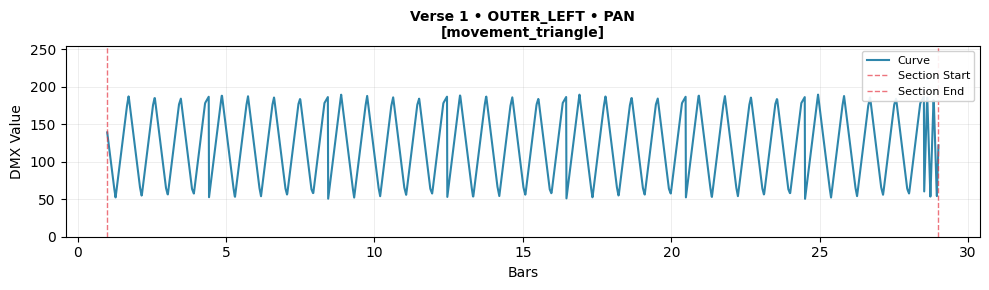
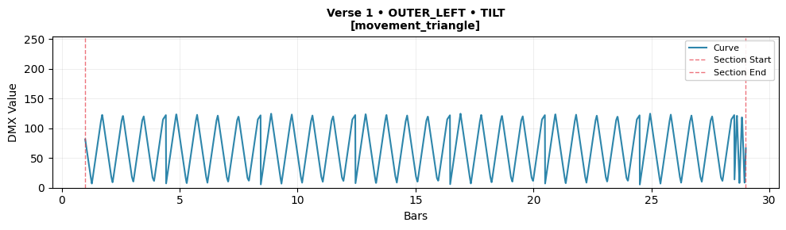
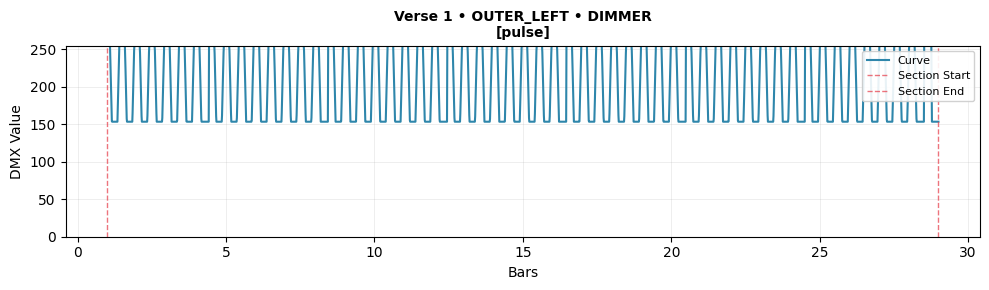

**Metrics**:
- pan [movement_triangle] (__default__): min=0.20, max=0.74, range=0.55, clamp=0.0%, energy=0.014, loop=✗ (0.068), base=0.10 ⚠️, speed=134.1°/s, accel=16447°/s²
- tilt [movement_triangle] (__default__): min=0.02, max=0.49, range=0.47, clamp=0.0%, energy=0.012, loop=✗ (0.059), base=0.50 ⚠️, speed=57.5°/s, accel=7049°/s²
- dimmer [pulse] (__default__): min=0.60, max=1.00, range=0.40, clamp=37.7%, energy=0.016, loop=✓

**Template Compliance**:
- Overall: ✓ Compliant
- Curve types: ✓
- Geometry: ✓

**Flags**:
- ❌ **PHYSICS_VIOLATION**: Acceleration 16447.2°/s² exceeds limit 1000.0°/s²
- ⚠️ **LOOP_DISCONTINUITY**: Loop discontinuity: delta=0.068
- ❌ **PHYSICS_VIOLATION**: Acceleration 7048.8°/s² exceeds limit 1000.0°/s²
- ⚠️ **LOOP_DISCONTINUITY**: Loop discontinuity: delta=0.059

**Transition to Verse 2**:
- Status: ✓ Smooth
- Position delta: pan=0.001, tilt=0.001
- Velocity delta: 0.000

---

### Verse 2 (bars 30.0–58.0)

**Template**: `split_lr_sweep_counter`

**Reasoning**: This section steps back to leave headroom for the break. split_lr_sweep_counter introduces the light_trails motif with smooth counter-sweeps, so the left and right halves mirror each other while acting as one lead group (COMPLEMENTARY). It also differs clearly from verse_1's pulsing fan. Short shutter pulses at bars 34 and 46 land on the 0.8 transients at about 26.8s and 36.6s, giving bright/dim contrast over the sweep base without sustained full-intensity holds. Colors stay traditional PRIMARY, and SMOOTH intensity keeps the motion fluid.

**Curves (OUTER_LEFT)**:

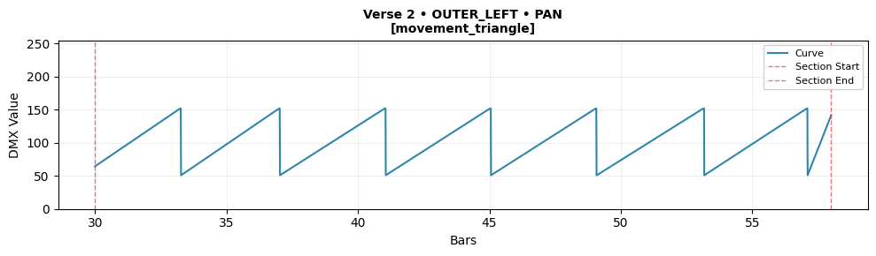
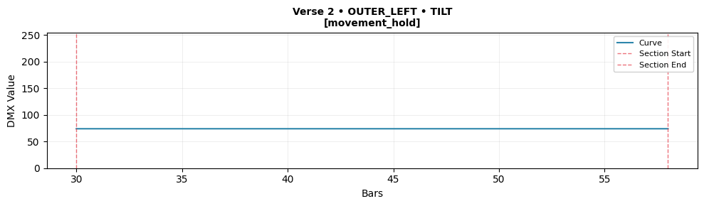
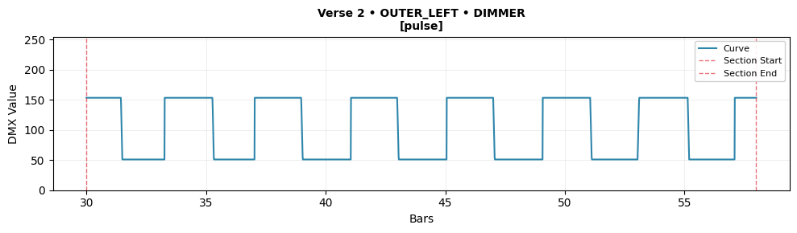

**Metrics**:
- pan [movement_triangle] (__default__): min=0.20, max=0.60, range=0.40, clamp=0.0%, energy=0.002, loop=✗ (0.303), base=0.28 ⚠️, speed=99.9°/s, accel=11982°/s²
- tilt [movement_hold] (__default__): min=0.29, max=0.29, range=0.00, clamp=0.0%, energy=0.000, loop=✓, base=0.54, speed=0.0°/s
- dimmer [pulse] (__default__): min=0.20, max=0.60, range=0.40, clamp=0.0%, energy=0.002, loop=✓

**Template Compliance**:
- Overall: ✓ Compliant
- Curve types: ✓
- Geometry: ✓

**Flags**:
- ❌ **PHYSICS_VIOLATION**: Acceleration 11981.8°/s² exceeds limit 1000.0°/s²
- ⚠️ **LOOP_DISCONTINUITY**: Loop discontinuity: delta=0.303

**Transition to Break|Spiral**:
- Status: ✓ Smooth
- Position delta: pan=0.002, tilt=0.001
- Velocity delta: 0.000

---

### Break (Segment spiral) (bars 59.0–70.0)

**Template**: `spiral_xross_blackout`

**Reasoning**: Spiral rotation in an X-cross carries the spiral motif. Its blackout punctuation gives brief bursts rather than long holds as energy dips toward the bar-71 valley.

**Curves (OUTER_LEFT)**:

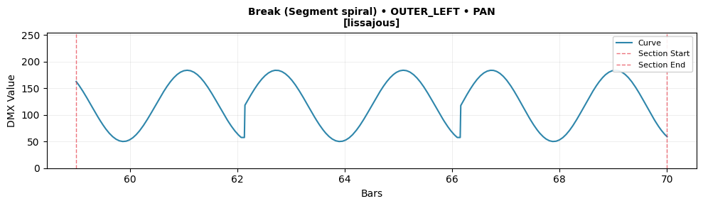
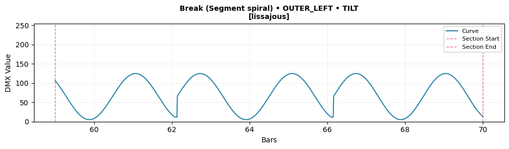
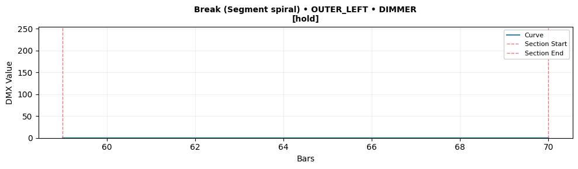

**Metrics**:
- pan [lissajous] (__default__): min=0.20, max=0.72, range=0.52, clamp=0.0%, energy=0.005, loop=✗ (0.405), base=0.40 ⚠️, speed=59.8°/s, accel=7113°/s²
- tilt [lissajous] (__default__): min=0.02, max=0.49, range=0.47, clamp=0.0%, energy=0.005, loop=✗ (0.363), base=0.47 ⚠️, speed=26.8°/s, accel=3188°/s²
- dimmer [hold] (__default__): min=0.00, max=0.00, range=0.00, clamp=100.0%, energy=0.000, loop=✓, static=0

**Template Compliance**:
- Overall: ✓ Compliant
- Curve types: ✓
- Geometry: ✓

**Flags**:
- ❌ **PHYSICS_VIOLATION**: Acceleration 7113.2°/s² exceeds limit 1000.0°/s²
- ⚠️ **LOOP_DISCONTINUITY**: Loop discontinuity: delta=0.405
- ❌ **PHYSICS_VIOLATION**: Acceleration 3188.0°/s² exceeds limit 1000.0°/s²
- ⚠️ **LOOP_DISCONTINUITY**: Loop discontinuity: delta=0.363

**Transition to Break|Build**:
- Status: ✓ Smooth
- Position delta: pan=0.001, tilt=0.001
- Velocity delta: 0.000

---

### Break (Segment build) (bars 71.0–79.0)

**Template**: `sweep_ud_chevron_swell`

**Reasoning**: A chevron lift with a swelling dimmer turns the strongest sampled rise in the song into the first real build, cresting at bar 79.

**Curves (OUTER_LEFT)**:

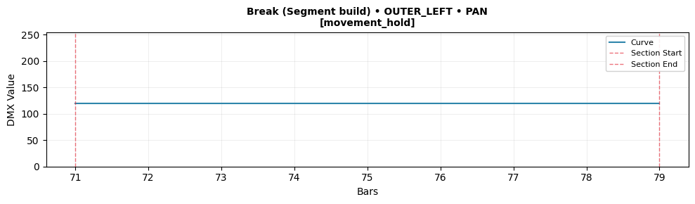
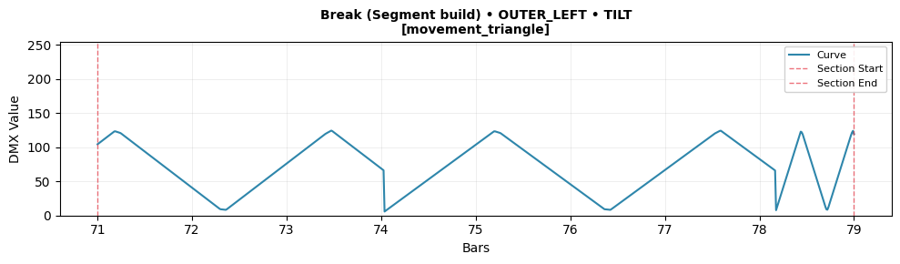
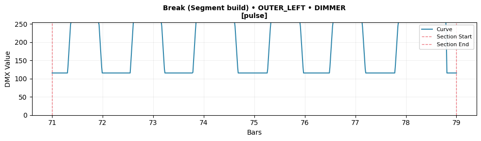

**Metrics**:
- pan [movement_hold] (__default__): min=0.47, max=0.47, range=0.00, clamp=0.0%, energy=0.000, loop=✓, base=0.35, speed=0.0°/s
- tilt [movement_triangle] (__default__): min=0.02, max=0.49, range=0.46, clamp=0.0%, energy=0.006, loop=✗ (0.059), base=0.38 ⚠️, speed=29.8°/s, accel=3689°/s²
- dimmer [pulse] (__default__): min=0.45, max=1.00, range=0.55, clamp=49.9%, energy=0.009, loop=✓

**Template Compliance**:
- Overall: ✓ Compliant
- Curve types: ✓
- Geometry: ✓

**Flags**:
- ❌ **PHYSICS_VIOLATION**: Acceleration 3689.1°/s² exceeds limit 1000.0°/s²
- ⚠️ **LOOP_DISCONTINUITY**: Loop discontinuity: delta=0.059

**Transition to Break|Release**:
- Status: ✓ Smooth
- Position delta: pan=0.000, tilt=0.001
- Velocity delta: 0.000

---

### Break (Segment release) (bars 80.0–87.0)

**Template**: `cascade_pulse_lr`

**Reasoning**: After the peak, energy settles around 0.34. A left-to-right pulse cascade holds a mid-level groove on the 2-beat grid instead of going dark.

**Curves (OUTER_LEFT)**:

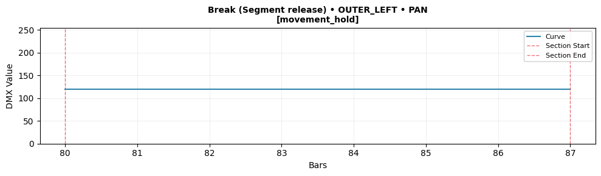

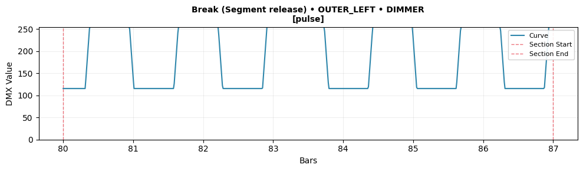

**Metrics**:
- pan [movement_hold] (__default__): min=0.47, max=0.47, range=0.00, clamp=0.0%, energy=0.000, loop=✓, base=0.10, speed=0.0°/s
- tilt [movement_hold] (__default__): min=0.25, max=0.25, range=0.00, clamp=0.0%, energy=0.000, loop=✓, base=0.50, speed=0.0°/s
- dimmer [pulse] (__default__): min=0.45, max=1.00, range=0.55, clamp=45.1%, energy=0.009, loop=✓

**Template Compliance**:
- Overall: ✓ Compliant
- Curve types: ✓
- Geometry: ✓

**Flags**: None

**Transition to Verse 3|Plateau**:
- Status: ✓ Smooth
- Position delta: pan=0.001, tilt=0.000
- Velocity delta: 0.000

---

### Verse 3 (Segment plateau) (bars 88.0–103.0)

**Template**: `sweep_lr_continuous_phase`

**Reasoning**: A loop-safe continuous sweep with phase offsets gives a steady grid-locked trail chase across the 0.39-0.44 plateau.

**Curves (OUTER_LEFT)**:

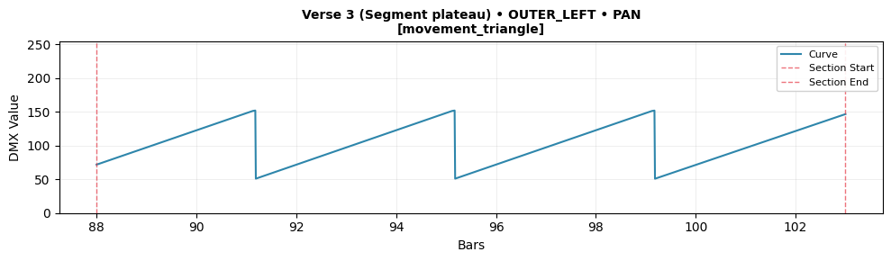
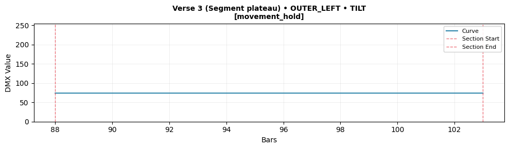
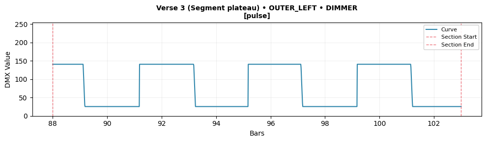

**Metrics**:
- pan [movement_triangle] (__default__): min=0.20, max=0.60, range=0.40, clamp=0.0%, energy=0.002, loop=✗ (0.294), base=0.10 ⚠️, speed=99.9°/s, accel=11914°/s²
- tilt [movement_hold] (__default__): min=0.29, max=0.29, range=0.00, clamp=0.0%, energy=0.000, loop=✓, base=0.50, speed=0.0°/s
- dimmer [pulse] (__default__): min=0.10, max=0.55, range=0.45, clamp=0.0%, energy=0.002, loop=✓

**Template Compliance**:
- Overall: ✓ Compliant
- Curve types: ✓
- Geometry: ✓

**Flags**:
- ❌ **PHYSICS_VIOLATION**: Acceleration 11913.5°/s² exceeds limit 1000.0°/s²
- ⚠️ **LOOP_DISCONTINUITY**: Loop discontinuity: delta=0.294

**Transition to Verse 3|Dip**:
- Status: ✓ Smooth
- Position delta: pan=0.003, tilt=0.001
- Velocity delta: 0.000

---

### Verse 3 (Segment dip) (bars 104.0–107.0)

**Template**: `inner_pendulum_breathe`

**Reasoning**: Inner fixtures run alone with a subtle pendulum and breathing dimmer, cutting to a minimal accent layer for about 3s at the energy dip.

**Curves (INNER_LEFT)**:

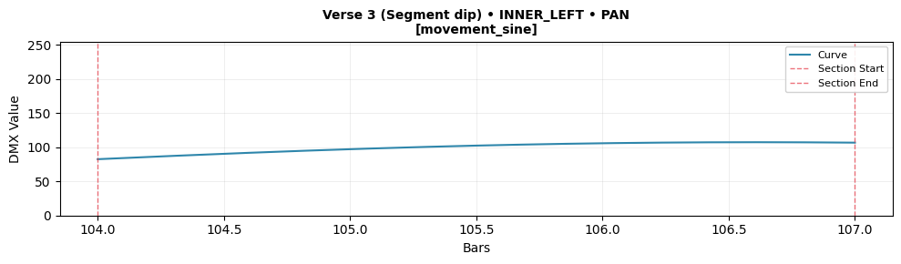
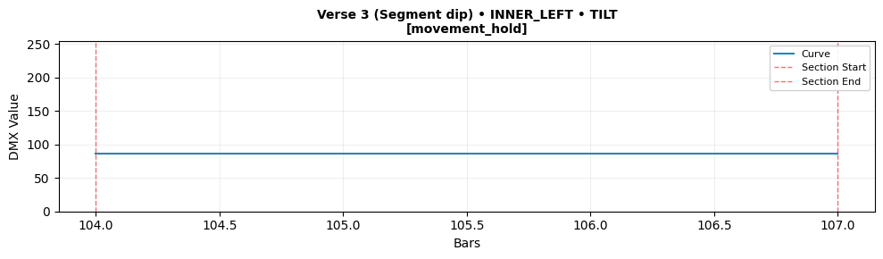
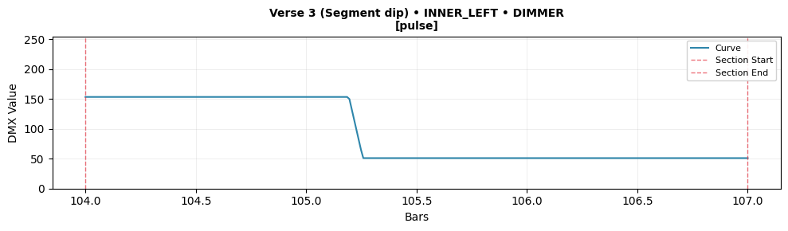

**Metrics**:
- pan [movement_sine] (__default__): min=0.32, max=0.42, range=0.10, clamp=0.0%, energy=0.000, loop=✗ (0.095), base=0.30, speed=0.2°/s, accel=1°/s²
- tilt [movement_hold] (__default__): min=0.34, max=0.34, range=0.00, clamp=0.0%, energy=0.000, loop=✓, base=0.50, speed=0.0°/s
- dimmer [pulse] (__default__): min=0.20, max=0.60, range=0.40, clamp=0.0%, energy=0.001, loop=✓

**Template Compliance**:
- Overall: ✓ Compliant
- Curve types: ✓
- Geometry: ✓

**Flags**:
- ℹ️ **LIMITED_RANGE**: Curve has limited range: 0.098
- ⚠️ **LOOP_DISCONTINUITY**: Loop discontinuity: delta=0.095

**Transition to Verse 3|Rebuild**:
- Status: ✓ Smooth
- Position delta: pan=0.003, tilt=0.002
- Velocity delta: 0.000

---

### Verse 3 (Segment rebuild) (bars 108.0–116.0)

**Template**: `zigzag_alternating_pulse`

**Reasoning**: Tighter zigzag motion with matched pulses rebuilds through 0.32, 0.42 and 0.46, winding up energy into the chorus.

**Curves (OUTER_LEFT)**:

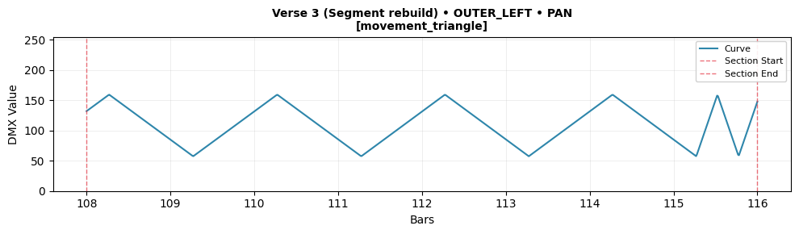
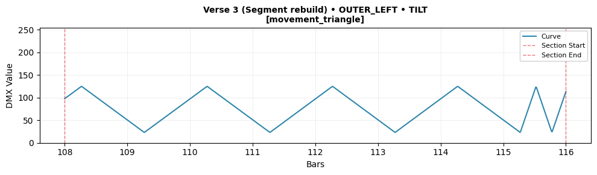
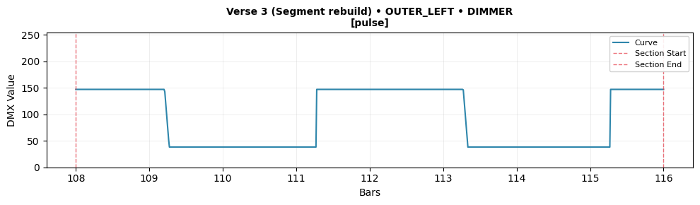

**Metrics**:
- pan [movement_triangle] (__default__): min=0.23, max=0.62, range=0.40, clamp=0.0%, energy=0.005, loop=✗ (0.062), base=0.42, speed=4.2°/s, accel=593°/s²
- tilt [movement_triangle] (__default__): min=0.09, max=0.49, range=0.40, clamp=0.0%, energy=0.005, loop=✗ (0.062), base=0.30, speed=2.1°/s, accel=296°/s²
- dimmer [pulse] (__default__): min=0.15, max=0.58, range=0.43, clamp=0.0%, energy=0.002, loop=✓

**Template Compliance**:
- Overall: ✓ Compliant
- Curve types: ✓
- Geometry: ✓

**Flags**:
- ⚠️ **LOOP_DISCONTINUITY**: Loop discontinuity: delta=0.062
- ⚠️ **LOOP_DISCONTINUITY**: Loop discontinuity: delta=0.062

**Transition to Chorus|Wave1**:
- Status: ✓ Smooth
- Position delta: pan=0.001, tilt=0.000
- Velocity delta: 0.000

---

### Chorus (Segment wave1) (bars 117.0–128.0)

**Template**: `dual_sweep_audience_pulse`

**Reasoning**: Symmetric counter-sweeping beams scan the street audience with rapid pulses. This is the confident first wave, opening on the single max hit.

**Curves (OUTER_LEFT)**:

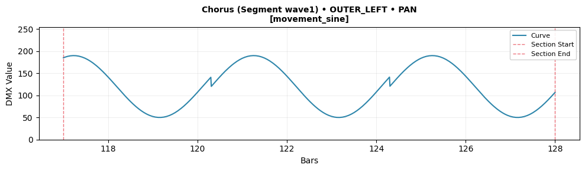
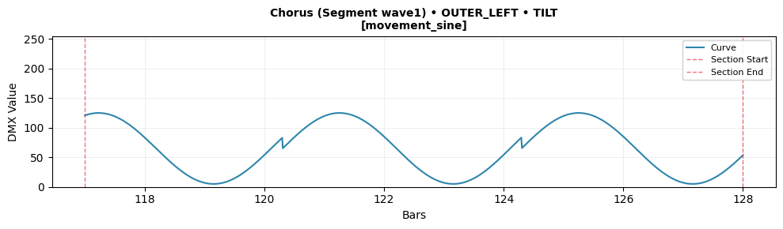
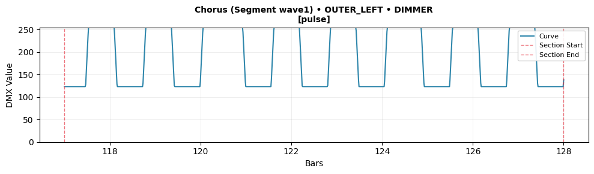

**Metrics**:
- pan [movement_sine] (__default__): min=0.20, max=0.74, range=0.55, clamp=0.0%, energy=0.003, loop=✗ (0.307), base=0.20 ⚠️, speed=20.3°/s, accel=2559°/s²
- tilt [movement_sine] (__default__): min=0.02, max=0.49, range=0.47, clamp=0.0%, energy=0.003, loop=✗ (0.263), base=0.30 ⚠️, speed=8.7°/s, accel=1097°/s²
- dimmer [pulse] (__default__): min=0.48, max=1.00, range=0.52, clamp=45.7%, energy=0.008, loop=✓

**Template Compliance**:
- Overall: ✓ Compliant
- Curve types: ✓
- Geometry: ✓

**Flags**:
- ❌ **PHYSICS_VIOLATION**: Acceleration 2558.7°/s² exceeds limit 1000.0°/s²
- ⚠️ **LOOP_DISCONTINUITY**: Loop discontinuity: delta=0.307
- ❌ **PHYSICS_VIOLATION**: Acceleration 1096.6°/s² exceeds limit 1000.0°/s²
- ⚠️ **LOOP_DISCONTINUITY**: Loop discontinuity: delta=0.263

**Transition to Chorus|Pullback**:
- Status: ✓ Smooth
- Position delta: pan=0.001, tilt=0.001
- Velocity delta: 0.000

---

### Chorus (Segment pullback) (bars 129.0–132.0)

**Template**: `fan_pulse`

**Reasoning**: A static radial fan with pulsing dimmer creates a breath at the energy sag near 103.8s, restating the radial_rays motif.

**Curves (OUTER_LEFT)**:

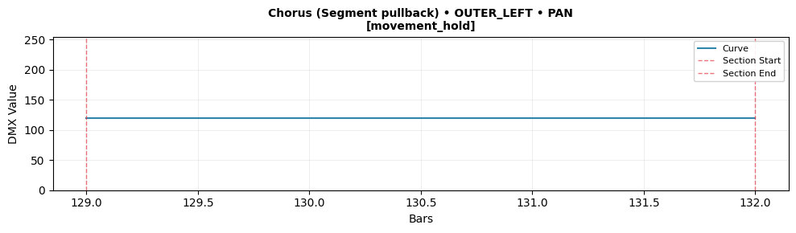
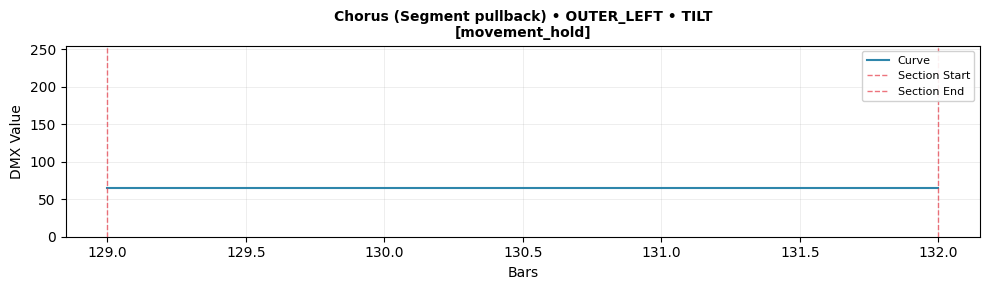
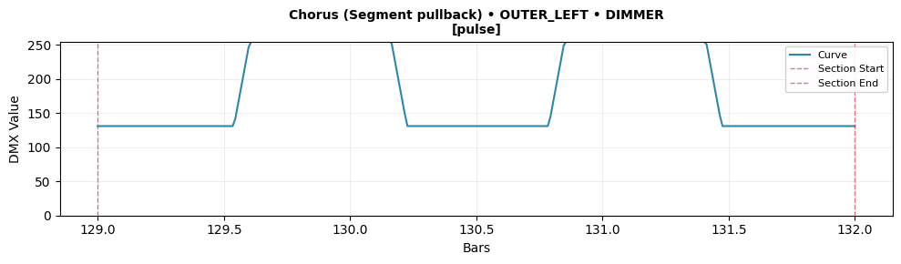

**Metrics**:
- pan [movement_hold] (__default__): min=0.47, max=0.47, range=0.00, clamp=0.0%, energy=0.000, loop=✓, base=0.28, speed=0.0°/s
- tilt [movement_hold] (__default__): min=0.25, max=0.25, range=0.00, clamp=0.0%, energy=0.000, loop=✓, base=0.35, speed=0.0°/s
- dimmer [pulse] (__default__): min=0.51, max=1.00, range=0.49, clamp=36.9%, energy=0.007, loop=✓

**Template Compliance**:
- Overall: ✓ Compliant
- Curve types: ✓
- Geometry: ✓

**Flags**: None

**Transition to Chorus|Wave2**:
- Status: ✓ Smooth
- Position delta: pan=0.001, tilt=0.001
- Velocity delta: 0.000

---

### Chorus (Segment wave2) (bars 133.0–145.0)

**Template**: `circle_asym_right_pulse`

**Reasoning**: Rotational circle motion with pulsing dimmer carries the spiral motif through the rebound to 0.51 and the finishing 0.517 push.

**Curves (OUTER_LEFT)**:

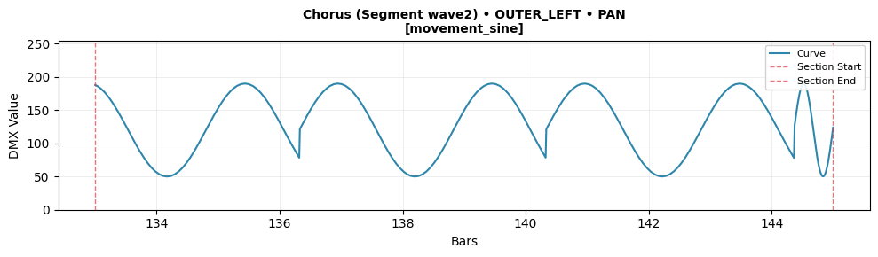
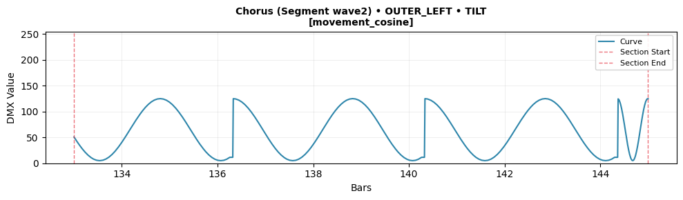
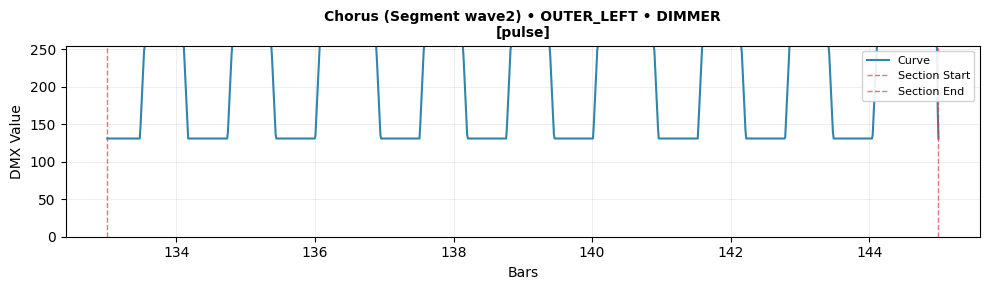

**Metrics**:
- pan [movement_sine] (__default__): min=0.20, max=0.74, range=0.55, clamp=0.0%, energy=0.006, loop=✗ (0.251), base=0.17 ⚠️, speed=48.5°/s, accel=5963°/s²
- tilt [movement_cosine] (__default__): min=0.02, max=0.49, range=0.47, clamp=0.0%, energy=0.005, loop=✗ (0.290), base=0.30 ⚠️, speed=56.0°/s, accel=6686°/s²
- dimmer [pulse] (__default__): min=0.51, max=1.00, range=0.49, clamp=49.2%, energy=0.008, loop=✓

**Template Compliance**:
- Overall: ✓ Compliant
- Curve types: ✓
- Geometry: ✓

**Flags**:
- ❌ **PHYSICS_VIOLATION**: Acceleration 5962.9°/s² exceeds limit 1000.0°/s²
- ⚠️ **LOOP_DISCONTINUITY**: Loop discontinuity: delta=0.251
- ❌ **PHYSICS_VIOLATION**: Acceleration 6686.4°/s² exceeds limit 1000.0°/s²
- ⚠️ **LOOP_DISCONTINUITY**: Loop discontinuity: delta=0.290

**Transition to Bridge|Showcase**:
- Status: ✓ Smooth
- Position delta: pan=0.001, tilt=0.001
- Velocity delta: 0.000

---

### Bridge (Segment showcase) (bars 146.0–158.0)

**Template**: `pendulum_chevron_breathe`

**Reasoning**: A smooth pendulum over a chevron with breathing dimmer gives slow trail sweeps that carry the last strong moments with restraint.

**Curves (OUTER_LEFT)**:

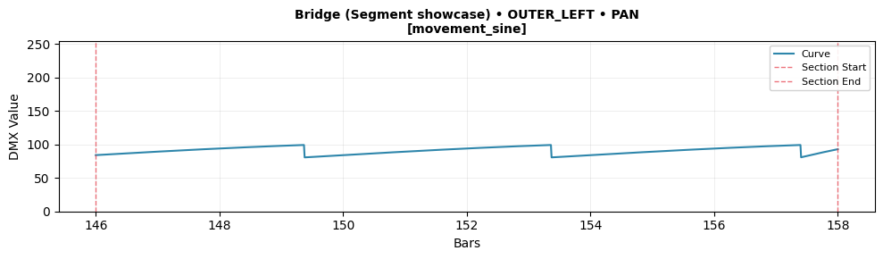

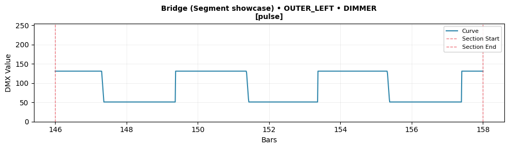

**Metrics**:
- pan [movement_sine] (__default__): min=0.32, max=0.39, range=0.07, clamp=0.0%, energy=0.000, loop=✓, base=0.35 ⚠️, speed=18.3°/s, accel=2187°/s²
- tilt [movement_hold] (__default__): min=0.38, max=0.38, range=0.00, clamp=0.0%, energy=0.000, loop=✓, base=0.38, speed=0.0°/s
- dimmer [pulse] (__default__): min=0.20, max=0.51, range=0.31, clamp=0.0%, energy=0.002, loop=✓

**Template Compliance**:
- Overall: ✓ Compliant
- Curve types: ✓
- Geometry: ✓

**Flags**:
- ℹ️ **LIMITED_RANGE**: Curve has limited range: 0.073
- ❌ **PHYSICS_VIOLATION**: Acceleration 2187.0°/s² exceeds limit 1000.0°/s²

**Transition to Bridge|Winddown**:
- Status: ✓ Smooth
- Position delta: pan=0.001, tilt=0.000
- Velocity delta: 0.000

---

### Bridge (Segment winddown) (bars 159.0–167.0)

**Template**: `wave_vertical_spotlight_fade`

**Reasoning**: A vertical wave converging to a spotlight cluster with fade-out handles the wind-down inside the bridge, leaving the heads nearly dark for blackout.

**Curves (OUTER_LEFT)**:

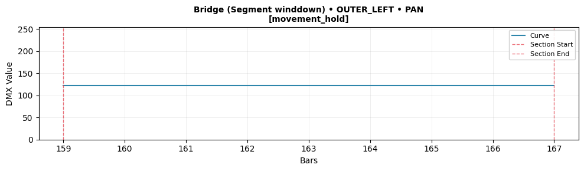
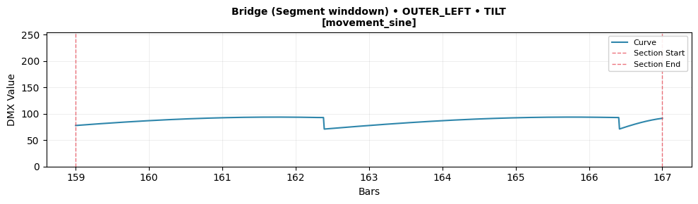
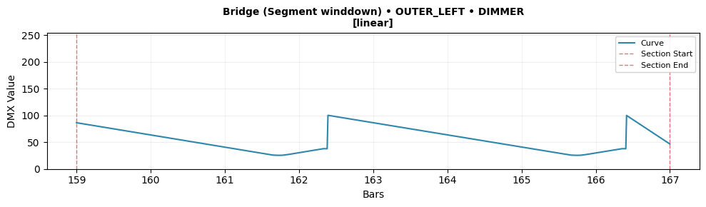

**Metrics**:
- pan [movement_hold] (__default__): min=0.48, max=0.48, range=0.00, clamp=0.0%, energy=0.000, loop=✓, base=0.48, speed=0.0°/s
- tilt [movement_sine] (__default__): min=0.28, max=0.37, range=0.09, clamp=0.0%, energy=0.001, loop=✗ (0.054), base=0.31 ⚠️, speed=10.8°/s, accel=1302°/s²
- dimmer [linear] (__default__): min=0.10, max=0.39, range=0.29, clamp=0.0%, energy=0.002, loop=✓

**Template Compliance**:
- Overall: ✓ Compliant
- Curve types: ✓
- Geometry: ✓

**Flags**:
- ℹ️ **LIMITED_RANGE**: Curve has limited range: 0.089
- ❌ **PHYSICS_VIOLATION**: Acceleration 1302.0°/s² exceeds limit 1000.0°/s²
- ⚠️ **LOOP_DISCONTINUITY**: Loop discontinuity: delta=0.054

---
